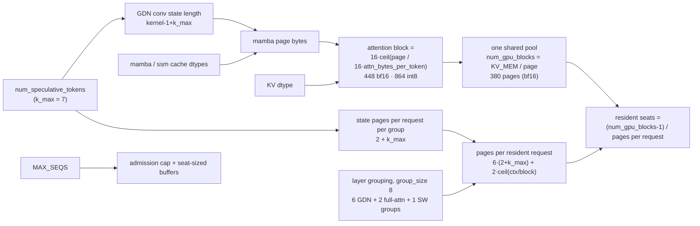

# Block sizing against seats on the hybrid stack: causes, guards, and a dynamic design

Qwen3.8-27B (`Qwen3_5ForConditionalGeneration`, 48 GDN + 16 full-attention layers, DFlash2 drafter with 5
sliding-window layers) on vLLM 0.31.0 with the repo's patches, one RTX 3090. Default launcher config: bf16 KV,
FLASH_ATTN, `--max-num-seqs 8`, `--max-model-len 65536`, `--kv-cache-memory=5583457484`, `--enable-prefix-caching
--mamba-cache-mode align`, dflash k=7.

vLLM paths are relative to `site-packages/` in the image `ghcr.io/syv-ai/hyperqwen:latest`
(`sha256:e99df7e6…cb9e`, vLLM 0.31.0 with the repo's patches applied). `bench/results/...`, `docs/...` and
`PATCHES.md` paths refer to branch `cline/gf59cdmh` unless noted. `single-user/start_qwen.sh` line numbers are from
`launcher-dynamic-k` (`a5d807e`) unless labelled `cline/gf59cdmh`. `[INFERENCE]` marks derived values and anything
not verified in code or on hardware.

## 1. Summary

The pool is **not** sized per seat, and its block size does not depend on `MAX_SEQS`. Three things are mis-sized,
and each one is decided at boot:

1. **Every resident request holds recurrent-state pages for the largest k, even when it decodes at a smaller k.**
   A request costs `6·(2 + k_max)` state pages plus attention pages. `DYNAMIC_K` drops the scheduled k to 3 at N≥4,
   but the pages stay sized for k=7. At N=4 that leaves about 96 of the pool's 380 pages allocated and never written
   (~25% of the pool). This is the "empty seat" cost that matters, and nothing in vLLM 0.31.0 prevents it.
2. **Seats are admissions, not residency, and the launcher's estimate of residency is wrong.** `MAX_SEQS=8` admits 8,
   but the default pool holds 6 requests at ~1k-token prompts and 1 at ~32k. The rest wait or preempt. The seat
   print on `launcher-dynamic-k` (`a5d807e`) uses a flat per-request constant and has no context term. It says
   "about 5" for every prompt length.
3. **Buffers sized by `MAX_SEQS` are paid for empty seats as well as occupied ones.** On the default bf16 FLASH_ATTN
   config these are small. On the int8 / Triton and `CTX=huge` profiles they are large enough to cost KV tokens, and
   at 16 seats on `CTX=huge` they kill the engine.

The block size itself (448 tokens on bf16, 864 on int8) is a side effect of forcing the GDN state page and the
attention page to be the same number of bytes. It follows k_max and KV dtype, not seats.

§8 lists existing upstream and HyperQwen work against each proposed fix. None implements 5.3 or 5.4 for this stack.

## 2. How the sizes are decided

| Step | What decides it | Source |
|---|---|---|
| GDN state shape | conv length `conv_kernel_size - 1 + num_spec`, where `num_spec = speculative_config.num_speculative_tokens` | `vllm/model_executor/models/qwen3_5.py:655-675`; `vllm/model_executor/layers/mamba/mamba_utils.py:279-300` |
| Attention block | `16 · cdiv(mamba_page, 16 · attn_page_1_token)`; raised if smaller | `vllm/platforms/interface.py:993-1013` (log line `:1006`) |
| Padding | mamba page padded up to the attention page (3.23% on bf16), accounted, not written | `vllm/platforms/interface.py:1016-1036`; `vllm/v1/kv_cache_interface.py:1073-1086` |
| Groups | 16 / 48 / 5 layers → group size 8 → 2 full-attention, 6 GDN, 1 SW group (+3 padding layers) | `vllm/v1/core/kv_cache_utils.py:1599-1642, 1644-1790`; boot logs: `group_size 8`, `Add 3 padding layers`, `kv cache group sizes [448 × 9]` |
| State pages per request | `2 + num_speculative_blocks` per GDN group in align mode; `num_speculative_blocks = num_speculative_tokens` | `vllm/v1/kv_cache_interface.py:1097-1100`; `vllm/model_executor/layers/mamba/abstract.py:78-82` |
| Per-step allocation | `cdiv(num_tokens, block_size) + num_speculative_blocks` | `vllm/v1/core/single_type_kv_cache_manager.py:1832-1834, 1910-1911` |
| Pool | `num_blocks = available // bytes_per_block`, one shared free list for every group | `vllm/v1/core/kv_cache_utils.py:1958-1961`; `vllm/v1/core/block_pool.py:680-691` |

The whole design rests on one constraint from upstream: "Physical memory per block: Must be the same across all KV
cache groups. Breaking this assumption is non-trivial due to memory fragmentation concerns"
(`vllm/v1/core/kv_cache_utils.py:1672-1675`). Equal page bytes everywhere is what couples the attention block to the
GDN state.

Measured per-request cost: 6(k+2) state pages exactly, 54 / 30 / 18 at k = 7 / 3 / 1 (int8; batch 4 Q1,
`bench/results/2026-10-15-Q1-seat-gauge/report.md`). On bf16 k=7: 57.5 / 204 / 332 pages at ~1k / ~32.8k / ~61.5k
prompts (`bench/results/2026-10-15-Q2-d-k7-shippedkv/raw-q2-table.log`). That matches `54 + 2·ceil(ctx/448)`
(202 and 330) to within 2 pages `[INFERENCE]`.

Seats are not reserved. State and KV pages come out of the shared pool at admission and at every step. A request
that does not fit waits in the queue (`vllm/v1/core/sched/scheduler.py:1225-1231`), and a running one that cannot grow
is preempted and recomputed (`scheduler.py:746-817`, `_preempt_request` frees everything and resets
`num_computed_tokens` at `:1556-1581`). `MAX_SEQS` only caps how many requests can be running
(`scheduler.py:896-902`) and sizes the buffers in §3.3.

## 3. Causes

### 3.1 State pages are sized for k_max: the dynamic-k mismatch

Every allocation that involves k reads the maximum: the conv-state shape, `num_speculative_blocks`, the state index
width, the scheduler's spec budget and reserved spec blocks, `draft_slots`, the per-step lookahead, the graph
`decode_query_len` and the sampler warmup. The per-batch tier from `num_speculative_tokens_per_batch_size` is only
used for how many drafts get scheduled and which captured graph runs:

- Built at `vllm/v1/core/sched/scheduler.py:293-299`, looked up per step at `:1445-1451`, and shipped as
  `SchedulerOutput.num_spec_tokens_to_schedule`.
- Async placeholders `async_scheduler.py:29-47`.
- The trim `scheduler.py:2559-2571`.
- The graph tiers `vllm/config/vllm.py:2496-2533` and `vllm/v1/worker/gpu/cudagraph_utils.py:270-291`.

Today's A/B confirms it on hardware (`bench/results/2026-10-16-dynamic-k-ab-salted/` on this branch):

- **Same pool in both arms:** A and B boot with the same 448-token block, the same 3.23% padding and the same
  68,605-token pool.
- **Only the graph count differs:** 8 FULL graphs in A against 13 in B.
- **Warmup is sized for k=7 in both arms:** "Warmed rejection-sampler kernels (k=7…)" appears in both boot logs.

What it costs on the default bf16 pool (380 pages, ~14.69 MB per page `[INFERENCE: KV_MEM / num_gpu_blocks]`):

| Prompt | Pages per request, k=7 (today) | If state followed the k=3 tier | Seats today | Seats if tier-aware |
|---|---|---|---|---|
| ~1k | 57.5 (measured) | ~33.5 | 6 (measured) | ~11 `[INFERENCE]` |
| ~4k | ~74 `[INFERENCE]` | ~50 | ~5 | ~7 |
| ~32k | 204 (measured) | ~180 | 1 (measured) | ~2 |

Each request at the k=3 tier holds 6 × (7 − 3) = **24 pages (~353 MB) that are allocated and never written**. At N=4
that is 96 pages, a quarter of the pool. This is why the first result in batch 3 read "a per-step k schedule frees 0
seats" (`bench/results/2026-10-14-batch3-SUMMARY.md:28-30`). The schedule buys step time (−24% ms/pass at N=4 today)
but not capacity.

The page size itself barely depends on k: int8 blocks are 864 at k=7 and 816 at k=3, about 6%. The cost lives in
the number of slot pages, `2 + k`, not in the bytes per page.

### 3.2 Seats are not residency, and the estimate is miscalibrated

`MAX_SEQS=8` admits 8 requests. The default bf16 pool holds 6 at ~1k and 1 at ~32k (Q2-d table). The two seats above
the fit get admitted and then wait (`Running: 6 reqs, Waiting: 10 reqs, GPU KV cache usage: 93.4%` in the same
report). Once running requests grow past the pool, they preempt and recompute.

The launcher's warning disagrees with the engine, and the disagreement differs by branch:

| Branch | Seat print | What it says for the default bf16 k=7 config | Measured |
|---|---|---|---|
| `launcher-dynamic-k` / `dynamic-k-results` (`a5d807e`, `single-user/start_qwen.sh:457-465`) | `KV_MEM / ((k+2) × 104,988,089)` | "about 5", whatever the prompt length | 6 at ~1k, 1 at ~32k |
| `cline/gf59cdmh` (`single-user/start_qwen.sh:472-488`) | range from page 14,601,709 (int8, k=7) and block 448 | "6 to 7" on ~1k prompts | 6 at ~1k |

The flat constant is 20-29% above the short-prompt cost and has no context term (batch 4 Q1). The batch-5 form used
block 864 on bf16, where the real block is 448, and so charged about half the true context cost: 130 pages instead of
204 at ~32k (Q2-d report, §3 note 3). The newer range form is closer, but its page constant is int8 k=7 at every k.
At int8 k=3 it gives "10 to 12" where 13 seat `[INFERENCE]`. Every one of these errors comes from the same source:
the launcher runs before the engine chooses its block and pool, so it has to guess them.

### 3.3 Buffers sized by MAX_SEQS, paid for empty seats

These are allocated once at boot from `max_num_seqs`. An empty seat costs the same as an occupied one.

| Buffer | Size rule | Default bf16 config | Source |
|---|---|---|---|
| int4/3D attention scratch (Triton int8/int4 path) | `min(max_num_batched_tokens, min(max_num_seqs, 32) × 16)` rows | **not allocated** (0 `3D scratch` lines in today's boots) | `vllm/v1/attention/backends/triton_attn.py:143-166`; 48.38 → 96.75 → 145.12 MiB at 8 / 16 / 24 seats on int8 boots |
| CUDA-graph capture budget | `CG = MAX_SEQS × (k+1)`, capped at 64 by the launcher | 64 | `single-user/start_qwen.sh:441-449`; `docs/gotchas.md:482-494` |
| GDN decode graph batch | `max_num_seqs × (k+1)`, capped by capture size | 64 | `vllm/v1/attention/backends/gdn_attn.py:131-136` |
| DFlash2 speculator buffers | `(max_num_reqs, steps, top_k)` and similar | small `[INFERENCE]` | `vllm/v1/worker/gpu/spec_decode/dflash/speculator.py:122-330` |
| Input batch, token ids | `max_num_reqs × max_model_len` int32 + bool | 2.5 MiB at 8 seats | `vllm/v1/worker/gpu_input_batch.py:132-144` |
| M-RoPE staged positions | `max_num_reqs × num_dims × max_model_len` int32, pinned | `num_dims × 0.25 MiB` per seat `[INFERENCE]` | `vllm/v1/worker/gpu/mm/rope.py:41-50` |
| GDN state index table | `groups × max_num_reqs × (1+k)` int32 | 1.5 KiB | `vllm/v1/worker/mamba_utils.py:903-911` |

Measured consequences:

- **Host Shared Usage step:** 8.0 / 16.0 / 32.0 MiB at 8 / 16 / 24 seats, independent of free VRAM
  (`docs/gotchas.md:1500-1505`; batch 4 Q4). Not a spill. The allocation behind it is not pinned down
  `[INFERENCE: token-id and M-RoPE host tables have that slope]`.
- **`CTX=huge` at 16 seats:** free VRAM after boot is 596 / 456 / 416 / 356 MiB at 8 / 10 / 12 / 16 seats. At 16 the
  engine dies on the first ~3.7k prompt with `torch.OutOfMemoryError` (`docs/gotchas.md:497-518`). The per-seat
  allocations of the first real batch take the transient headroom prefill needs.
- **Graphs past the budget:** `DFLASH_TOKENS=15 MAX_SEQS=8` asks for 128 query tokens of graphs. It boots, answers
  `/health`, and then dies on the first concurrent batch (`docs/gotchas.md:482-494`).
- **Single-stream at 16 seats:** C1 is −3.9% against 8 seats, from tok/step (3.17 against 3.34), not from ms/pass
  (32.6 against 32.3) (`bench/results/2026-10-15-Q5-a-k7-s16/report.md`). The only seat-scaled allocation that differs
  in those boot logs is the int8 scratch. Today's fixed-prompt run showed tok/step is set by the text being decoded,
  and batch 5 Q3 showed that graph and numerics changes fork greedy trajectories. So this −3.9% is probably
  trajectory drift, not a per-seat cost. `[INFERENCE]`: not yet re-run with `--salt`.

### 3.4 Geometry padding from the equal-page rule

The rule that every group has the same page bytes forces padding wherever layer types do not divide evenly:

- **SW group padding:** the drafter's 5-layer SW group carries 3 padding layers. The boot log prints "may waste at
  most 60%" of that group, about 7 MB per request (`hybrid-kv-groups-v2-cudagraph.patch` header).
- **Mamba page padding:** the GDN page is padded 3.23% up to the attention page.
- **Prefix-cache hit granularity:** hits are quantised by the block: `cached_tokens = max(0, floor(n/B) - 1) · B`
  (`docs/gotchas.md:713-726`). A large block, forced by the state page, makes short shared prefixes uncacheable.

## 4. What prevents it today

| Guard | What it prevents | Where |
|---|---|---|
| `hybrid-kv-groups-v2-cudagraph.patch` | group size taken from the 5-layer SW bucket (25% padding on every context token); now 8, padding on the SW group only. 45,383 → 69,758 tokens. | `PATCHES.md:34`; `vllm/v1/core/kv_cache_utils.py:1599-1642` |
| `hybrid-sw-block-promote.patch` | on int8, the drafter's SW layers stuck at block 16 with 385 nearly empty 1.71 MiB blocks (75.6% of the per-request budget). Block rounded up to a divisor of the primary block. | `PATCHES.md:36`; patch header :1-63 |
| `spec-decode-scratch-within-budget.patch` | seat-sized scratch allocated outside the profiled window, invisible to the KV budget (+182 MiB resident at 64 seats) | `PATCHES.md:52`; `docs/spec-decode-scratch-token-units.md` |
| `pinned-kv-empty-cache.patch` | pinned `KV_MEM` allocated on top of profiling leftovers (~0.8 GiB over-commit, silent WSL2 spill) | `PATCHES.md:71` |
| `cudagraph-memory-from-allocator.patch` | WSL2 driver reading 0 graph memory and refusing boots | `PATCHES.md:60` |
| Launcher `MAX_SEQS=8` default and `CG ≤ 64` cap | graph budget overruns; oversize batches run piecewise instead of dying | `single-user/start_qwen.sh:440-449` |
| Launcher warning above 12 seats at `CTX=huge` | the 16-seat first-prompt death (warns, does not clamp) | `single-user/start_qwen.sh:481-485` |
| `KV_MEM` pin (~1.4-1.5 GB free after boot today) | headroom for first-batch transients; WSL2 spill | `single-user/start_qwen.sh:395, 402`; today's `raw-smi-*.log` |
| Seat print | users reading `MAX_SEQS` as concurrency (but see §3.2) | `single-user/start_qwen.sh:457-465` |

Nothing prevents §3.1. The state pages for k_max are held for the whole life of every running request.

## 5. A proper dynamic solution

There are four layers, cheapest first. Layers 1-2 fix what users actually hit. Layer 3 fixes the dynamic-k waste.
Layer 4 is the structural fix upstream calls hard.

### 5.1 Launcher: read the geometry, don't guess it

The engine publishes everything the seat print needs on `vllm:cache_config_info`: `block_size`, `mamba_block_size`,
`num_gpu_blocks`, `kv_cache_size_tokens` and `kv_cache_max_concurrency` (`raw-metrics-q2d-w2.log:589`). Live blocks
in use are exact as `kv_cache_usage_perc × (num_gpu_blocks − 1)` (batch 4 Q1).

- **After `/health`,** the launcher, or a sidecar the launcher starts, reads those labels and prints
  `seats(ctx) = floor((num_gpu_blocks − 1) / (G_state·(2 + k_max) + G_attn·ceil(ctx / block)))`. Use `G_state = 6`
  and `G_attn = 2` here, or better, count the groups from the boot's `kv cache group sizes` line.
- **Drop the constants** (`104988089`, `14601709`, `864`). They are each correct for one config only.
- **Port this to `launcher-dynamic-k` first.** That branch still ships the flat formula.

### 5.2 Size `MAX_SEQS` from the pool, not the other way round

Past the pool's fit, extra seats only queue and pay §3.3. A dynamic default:

- **Rule:** `MAX_SEQS = min(user cap, seats(ctx_typical) at the smallest scheduled k)`. With `DYNAMIC_K` the smallest
  k is the last tier (3 here), because that is the tier in force when the seats are full.
- **Rounding:** round up to the next capture size so graphs still cover every batch.
- **Budget check:** keep the `CG ≤ 64` and `CTX=huge ≤ 12` checks. Better still, express both as "free VRAM after
  boot ≥ the first-batch floor (~436 MiB measured)" rather than seat counts, since that floor is the real constraint
  (`docs/gotchas.md:526-541`).

This has to wait for the engine's pool, so it is a two-pass boot or a post-boot `max_num_seqs` clamp. vLLM 0.31.0 has
no runtime knob for that `[INFERENCE: no such endpoint found in the extracted source]`. The cheap version is
`seats(ctx)` from 5.1, computed for the next boot and written to the env file.

### 5.3 Engine: state slots follow the scheduled k (fixes §3.1)

This is the actual dynamic solution, and the hooks are already there:

1. **Per-step tier:** the scheduler already computes the tier every step: `dynamic_sd_lookup[batch]`
   (`vllm/v1/core/sched/scheduler.py:1445-1451`).
2. **Pass it to the GDN manager:** pass that k (per step, or per request) into
   `MambaManager.get_num_blocks_to_allocate` and `allocate_new_blocks` in place of the fixed
   `self.num_speculative_blocks` (`vllm/v1/core/single_type_kv_cache_manager.py:1497, 1832-1834, 1910-1911, 1965-1966`).
3. **Free on shrink:** when the tier drops, free the surplus spec slot pages. `remove_skipped_blocks` already nulls
   and frees stale state pages mid-flight (`:1688-1746`).
4. **Grow on rise:** when the tier rises, as N drops back below 4, allocate the extra slot pages before the step.
   **If the pool cannot supply them, clamp that request's k for the step rather than preempt.** Effective k becomes
   `min(tier(batch), k that fits the free pool)`. This also makes k back off as memory gets tight, which is the right
   behaviour under load.
5. **No tensor shape changes:** the state index table is already `1 + k_max` wide (`mamba_utils.py:903-911`), the
   conv-state page stays sized for k_max, and graphs are already captured per tier. So the block size and pool stay
   as they are, and the saving is the `6·(k_max − k)` slot pages per request.
6. **Admission rules:** admission (`scheduler.py:3048-3059`, `:583-584`) and the lookahead (`vllm/config/vllm.py:646-647`)
   use the tier that would be in force once the request joins. The `full_sequence_must_fit` gate
   (`kv_cache_manager.py:528-537`) keeps k_max, so a request admitted at k=3 can never be preempted just by the batch
   shrinking.

Expected effect on the default pool: ~6 → ~11 resident at ~1k prompts and ~5 → ~7 at ~4k when the k=3 tier is in
force (§3.1 table) `[INFERENCE]`. That moves the k=3-vs-`SPEC=off` crossover in batch 4 Q2 upward, because k=3's
weakness there was seats, not step time.

Risks to check before believing it:

- **Allocation order:** the tier must be known before `allocate_slots` for the step. Both happen in `schedule()`, but
  the order is not verified `[INFERENCE]`.
- **Async scheduling:** placeholders are sized per tier (`async_scheduler.py:29-47`). A k that changes between steps
  must not leave a placeholder pointing at a freed slot.
- **Prefix-cache checkpoints:** with align mode and `VLLM_MAMBA_ALIGN_KEEP_CHECKPOINTS`, checkpoint state pages are
  kept per request (`single_type_kv_cache_manager.py:1727-1744`). Only freed spec slots may be returned, never
  checkpoints.
- **Rollback:** accepted-token rollback copies state from slot `1 + accepted` (`vllm/v1/worker/mamba_utils.py:1444-1498`).
  A clamped k must also clamp the accepted range.

### 5.4 Structural: break the equal-page coupling

The root of the block-size coupling is the single shared pool with one page size
(`vllm/v1/core/kv_cache_utils.py:1145-1150, 1672-1675`; `vllm/platforms/interface.py:1016-1017`). The options:

- **Per-group pools.** GDN state gets its own pool of state-sized pages, and attention gets its own pool with a small
  block (16-64 tokens). That removes the 448/864-token block, the 3.23% and SW padding, and the prefix-cache
  granularity loss. It also makes state cost a separate, explicit budget. Upstream calls it non-trivial: two pools
  can each be half empty while the other is full, so it needs a rebalancing policy, for example a movable split or
  migration in multi-page units.
- **State pages that are sub-pages.** Keep one pool, but let a GDN slot be a fixed fraction of a page, so k slots pack
  several to a page. This keeps one free list but needs a sub-allocator inside the page `[INFERENCE]`.

Either one is a vLLM change of a different size from 5.3. 5.3 gets most of the dynamic-k benefit without touching the
allocator, so do it first.

## 6. How to verify each layer

All measured with `bench/conc_ladder.py --salt <fixed>` (commit `53122c7` on `dynamic-k-results`), interleaved
boots, every rep kept.

| Layer | Measurement | Pass condition |
|---|---|---|
| 5.1 | printed seats against `Running:` at ~1k / 4k / 32k on bf16 and int8, k = 7 / 3 | exact, or −1 at most, at every point |
| 5.2 | `MAX_SEQS` from the formula against 8, same pool | no preemptions at N = seats; no first-batch OOM; free VRAM after boot ≥ 436 MiB |
| 5.3 | pages per request at N=4 (`kv_cache_usage_perc × (num_gpu_blocks−1) / Running`) with `DYNAMIC_K` | ~33.5 at ~1k instead of 57.5; resident seats at ~1k ≥ 10; N=1 unchanged; zero preemptions when N drops 4 → 1 under a full pool |
| 3.3 re-check | `MAX_SEQS` 8 against 16, C1, fixed salt | settles whether the −3.9% is drift or per-seat cost |

## 7. Open points

- **Pool tokens per page:** the pool's token count does not scale with its page count across KV dtypes: bf16 68,605
  tokens for 380 pages against int8 116,440 for 382. `GPU KV cache size` also falls with `max_model_len` at fixed
  bytes. The repo records this as "no full account" (`docs/decode-speed-findings.md:111-113, 216`).
- **bf16 per-request pages at ~1k** average 57.5 rather than an integer `[INFERENCE: 6 × 54 + ~21 for 6 requests]`.
- **The host-memory step per seat** (1 MiB per seat) is not tied to one allocation.
- **Gotcha numbering:** the launcher comments and bench reports cite gotcha numbers 4 higher than today's
  `docs/gotchas.md`. Old 38 / 39 are now 34 / 35.

## 8. Prior work (searched 2026-10-16)

What already exists in vllm-project/vllm and in HyperQwen (`syv-ai/HyperQwen`, which `syv-ai/qwen38-27b-rtx3090`
redirects to; the fork has no PRs and has issues turned off).

- **Method:** PR and issue titles, bodies and comments, with diffs read for the PRs whose overlap depends on the code.
- **"In 0.31.0":** a merged PR counts as in the deployed version when `gh api compare v0.31.0...<merge sha>` reports
  it behind the tag. The release branch was cut on 2026-09-28, a week before the 2026-10-05 tag, so merge dates alone
  mislead.
- **Summary:** nothing implements 5.3 or 5.4 for this stack. Parts of every layer exist.

### 8.1 Per fix

| Fix | Closest existing work | State | Overlap |
|---|---|---|---|
| 5.3 state pages follow the scheduled k | [vllm#57658](https://github.com/vllm-project/vllm/pull/57658) "Fix Hybrid Mamba KV-cache admission for dynamic K" | open, needs rebase, unreviewed | **Partial, and not for align mode.** It threads a per-step `num_spec_override` through `allocate_slots` → coordinator → `MambaManager`, but applies it only under `if self.mamba_cache_mode != "align"` (confirmed in the diff). No free on shrink, no grow or clamp. It takes k from running + waiting rather than the scheduled batch, and also overrides the full-sequence admission check, which 5.3 keeps at k_max. Usable as the plumbing skeleton. |
| | [vllm#39562](https://github.com/vllm-project/vllm/pull/39562) | merged, in 0.31.0 | Align-mode `allocate_new_blocks` accepts a smaller requirement than the blocks held. A smaller k is safe, but the surplus is kept, not freed. |
| | [vllm#53542](https://github.com/vllm-project/vllm/pull/53542) | open | Narrows the GDN `spec_state_indices` view to the active k (claims 212 → 299 tok/s on Qwen3.8-27B, max k7, runtime k3). Speed only; "the preallocated buffer remains max-K-sized". |
| | [vllm#59759](https://github.com/vllm-project/vllm/pull/59759) | merged 2026-10-06, **not** in 0.31.0 | Edits the spec-block relocation and `physical_block_cap` lines a 5.3 patch would touch, and fixes MTP output after a prefix hit. Rebase onto it first. |
| | [vllm#49164](https://github.com/vllm-project/vllm/pull/49164) | closed unmerged | DFlash draft compute follows dynamic k; states that the max k "still controls worker allocation, scheduler lookahead, and KV-cache reservation". |
| | [vllm#55533](https://github.com/vllm-project/vllm/issues/55533), [RFC #59117](https://github.com/vllm-project/vllm/issues/59117), [#49548](https://github.com/vllm-project/vllm/issues/49548) | open | Cause 1 reported on this model class. #59117 names "the align-mode `2 + k` reservation" as the remaining gap. #49548 notes `num_lookahead_tokens` stays at the static k. |
| | local `2cbfdfa` (`cline/gf59cdmh`, docs item S-5) | branch | **Argues against 5.3:** "covering the largest k any step uses is the only correct behaviour". 5.3 answers this by freeing on shrink and clamping k when the pool cannot grow, so each step still holds the pages its own k needs. |
| 5.4 break the equal-page coupling | [vllm#37429](https://github.com/vllm-project/vllm/pull/37429) (dedicated Mamba pool) | open, stale | Partial: attention pages are still raised to the Mamba page. |
| | [vllm#39031](https://github.com/vllm-project/vllm/pull/39031) (one pool per group, natural page sizes) | closed by the author | The full option A, with the Mamba pool fixed at `max_seqs` blocks and no rebalancing. Abandoned. |
| | [vllm#46251](https://github.com/vllm-project/vllm/pull/46251) | open draft | Small attention blocks inside Mamba-sized large blocks, so attention keeps its natural block. The reverse of the sub-page idea in 5.4. |
| | [vllm#35703](https://github.com/vllm-project/vllm/pull/35703) `--attn-pack-size N` | open, stale | N attention layers per page, so the block is 1/N tokens. |
| | packed layout `_get_packed_kv_cache_groups` ([#40860](https://github.com/vllm-project/vllm/pull/40860), [#53896](https://github.com/vllm-project/vllm/pull/53896)) | merged, in 0.31.0 | Inactive here: FLASH_ATTN and Triton keep the default layer-outermost layout. [#58380](https://github.com/vllm-project/vllm/pull/58380) and [#60967](https://github.com/vllm-project/vllm/pull/60967) (open) would enable it and drop the Mamba padding; the block stays Mamba-coupled. |
| | `--prefix-match-unit` ([#46384](https://github.com/vllm-project/vllm/pull/46384)) | merged, in 0.31.0 | Solves the prefix-hit granularity half of §3.4 without changing allocation. On this stack it is switched off by [#51843](https://github.com/vllm-project/vllm/pull/51843): the DFlash sliding-window group cannot do sub-block lookups unless its block equals the match unit (unblocking: [#53786](https://github.com/vllm-project/vllm/issues/53786)). |
| | [vllm#58207](https://github.com/vllm-project/vllm/pull/58207), [#60252](https://github.com/vllm-project/vllm/pull/60252) | open | Upstream counterparts of `hybrid-kv-groups-v2-cudagraph.patch` (group size by padding bytes) and `hybrid-sw-block-promote.patch` (SW drafter block divides the primary block). |
| 5.1 launcher reads geometry | [#42967](https://github.com/vllm-project/vllm/pull/42967), [#50809](https://github.com/vllm-project/vllm/pull/50809), [#50462](https://github.com/vllm-project/vllm/pull/50462), [#42206](https://github.com/vllm-project/vllm/pull/42206) | merged, in 0.31.0 | **The data source is ready.** `vllm:cache_config_info` reports the resolved `block_size` and `mamba_block_size`, `kv_cache_size_tokens` and `kv_cache_max_concurrency`, computed after hybrid alignment. |
| | [vllm#54840](https://github.com/vllm-project/vllm/pull/54840) | open | Per-group block budget (`KVCacheBlockBudget`), the `G_state` / `G_attn` split 5.1 needs, but logged only, not on `/metrics`. |
| | HyperQwen `bench/harness.py` ([#302](https://github.com/syv-ai/HyperQwen/pull/302)), `bench/prefix_alternation.py` ([#184](https://github.com/syv-ai/HyperQwen/pull/184)) | merged | A `/metrics` parser to reuse. #184 notes that with an explicit `--block-size` (`CTX=huge` passes 128) the `block_size` label shows that value, so 5.1 should read `mamba_block_size` there `[INFERENCE]`. |
| | `d905cec`, `5ec9ca1` (`origin/cline/gf59cdmh`) | branch, no PR | The measured-function and range seat prints (§3.2), with `bench/test_resident_print.sh`. Constants still hard-coded. |
| 5.2 `MAX_SEQS` from the pool | [vllm#41371](https://github.com/vllm-project/vllm/pull/41371) | closed unmerged | Auto-clamped `max_num_seqs` to the block count. Maintainers preferred an error to a silent clamp. |
| | [vllm#54816](https://github.com/vllm-project/vllm/pull/54816), [#55018](https://github.com/vllm-project/vllm/pull/55018) | open | A live running-seat cap (no memory reclaim), and a re-init of the pool, graphs and scheduler with weights resident. The latter is the closest thing to the two-pass boot in 5.2. |
| | [vllm#38270](https://github.com/vllm-project/vllm/pull/38270) | merged, in 0.31.0 | Refuses to start when `max_num_seqs` exceeds the Mamba block count. A bound of 1 block per seat, far below the real `6·(2+k)` + attention. |
| Cause 3 seat-sized buffers | [vllm#46554](https://github.com/vllm-project/vllm/pull/46554) | closed unmerged | Lazy-grown token-id buffers, V1 runner only. Nothing exists for the V2 runner or the M-RoPE `prefill_positions` table. |
| | [vllm#56148](https://github.com/vllm-project/vllm/pull/56148) | merged 2026-10-13, not in 0.31.0 | **Upgrade risk:** spec-verify rows use split-K and the Triton scratch becomes `min(seq_threshold_3D, max_num_seqs) × (1+k)` rows, so it grows with seats × k. |
| | [vllm#50488](https://github.com/vllm-project/vllm/pull/50488) | merged, in 0.31.0 | Default capture sizes cover `max_num_seqs × (1+k)` with per-tier dynamic-SD sizes. Graph budget scales with seats × k. |

Note on §3.3: the `min(max_num_seqs, 32) × 16` rows rule is the repo's `spec-decode-scratch-token-units.patch`. Stock
0.31.0 sizes that scratch from `seq_threshold_3D` (`triton_attn.py`).

### 8.2 Cross-cutting findings

- **[vllm#60174](https://github.com/vllm-project/vllm/issues/60174) (open):** "DFlash2/DSpark + prefix caching corrupt
  output after a cache hit on Qwen3.8-27B (TP=1) on 0.30/0.31". That is the launcher's default spec + prefix-cache
  pairing.
  - **Trigger:** the thread's latest diagnosis is the drafter inheriting an fp8 KV cache with no scales, and bf16 KV
    is clean. This config is bf16 KV, so it should be unaffected `[INFERENCE]`.
  - **#55601:** the related fix ([vllm#55601](https://github.com/vllm-project/vllm/pull/55601), merged after 0.31.0)
    addresses a group whose block is smaller than `mamba_block_size`. Every group here is 448, the same as the
    mamba block.
  - **Test:** a hardware check on the default config is in
    `bench/results/2026-10-16-issue60174-prefix-cache/` on branch `issue-60174-check`.
- **[HyperQwen#329](https://github.com/syv-ai/HyperQwen/pull/329)** (`DYNAMIC_K`) and
  **[#330](https://github.com/syv-ai/HyperQwen/pull/330)** (`conc_ladder --salt`) are open upstream. #329 states "It
  adds no seats", which is cause 1.
- **Prior evidence for cause 2:** [HyperQwen#25](https://github.com/syv-ai/HyperQwen/issues/25) (open) is where
  "MAX_SEQS is not the knob" was established. [#40](https://github.com/syv-ai/HyperQwen/issues/40) and
  [#33](https://github.com/syv-ai/HyperQwen/issues/33) work out residency by hand.
- **Block size is fixed:** a maintainer comment on [HyperQwen#102](https://github.com/syv-ai/HyperQwen/issues/102)
  calls B "not configurable", because the attention page has to equal the Mamba page. §5.4 and the upstream rows above
  are the only ways around that.

### 8.3 Searched and not found

- Freeing spare spec state pages when k drops, growing them when k rises, or capping k to the free pool, in either
  repo.
- A rebalancing policy for two pools (movable split or migration).
- Packing one request's speculative state slots several to a page.
- Any per-group or Mamba-state usage gauge on `/metrics`.
- Any HyperQwen launcher code that reads `/metrics`.
