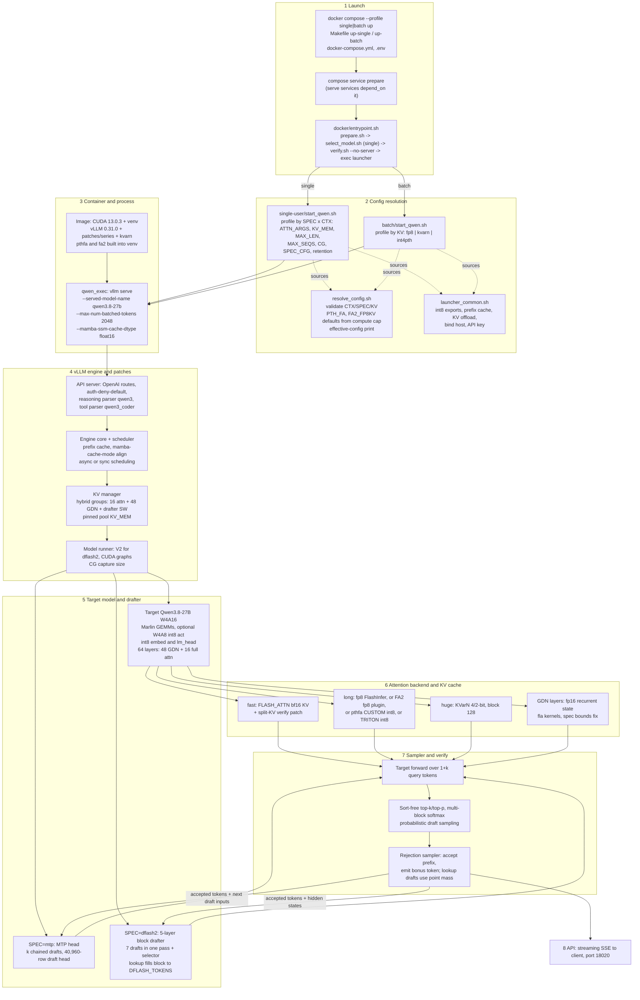

# Architecture: the inference pipeline end to end

Companion to [inventory.md](inventory.md). Branch `research/eagle4-expedition` (`95ac251`). Code cites are `path:line` in our tree; a cite into a `.patch` file is a line of that patch file. No GPU was used; the vLLM source is not in this repo, so engine behaviour is described through our patches and the repo's own docs.

Number labels:
- **measured (repo)**: stated in a repo doc, with the path. Native-Linux 3090 unless noted.
- **measured (prior GPU box)**: from `~/research-src/deepinfer-ref/docs/research/deepinfer/gpu-results/<file>`: RTX 3090 at 250 W, WSL2, stock image `2cf50a0`, 2026-10-20/21. About 6-14% under the native-Linux docs on A, B, C and E (`baseline.md`).
- **estimated**: my arithmetic, reasoning given.

## 1. End-to-end pipeline

Decode loop per engine step (single-user): target forward over `1 + k` query tokens (8 at `DFLASH_TOKENS=7`, 16 at 15), rejection sampling, then the drafter proposes the next block from the target's hidden states (DFlash2: layers 5/19/33/47/61, `docs/optimizations.md:211-215`) or from the MTP head chained k times. The lookup patch overwrites or extends proposals from the request's own token history (`patches/dflash2-lookup-drafting.patch:346-640`). Batch mode (A) runs none of the drafter or verify path.

Where each stage lives in code:

| Stage | Files |
|---|---|
| Launch | `docker-compose.yml`, `Makefile`, `docker/entrypoint.sh` |
| Config | `resolve_config.sh:56-206`, `launcher_common.sh`, `single-user/start_qwen.sh:185-1046`, `batch/start_qwen.sh:87-318` |
| Image and patches | `Dockerfile:14-64`, `patches/series:17-67`, `patches/apply.sh`, `kvarn/install.sh` |
| Spec config | `single-user/start_qwen.sh:394` (dflash2), `:666` (mtp) |
| Drafter | `patches/dflash2-lookup-drafting.patch`, `dflash2-ngram-chains.patch`, `qwen3_5-mtp-draft-vocab.patch` |
| Attention | `spec-decode-attn.patch`, `spec-decode-int8-kv.patch`, `triton-spec-attn-fp8-kv.patch`, `prefill-attn-int8.patch`, `pthfa/`, `fa2/`, `kvarn/` |
| KV memory | `hybrid-kv-groups-v2-cudagraph.patch`, `hybrid-sw-block-promote.patch`, `memory-profile-after-warmup.patch`, `pinned-kv-empty-cache.patch`, `kv-cache-seat-budget.patch` |
| Sampler / verify | `sampler-small-topk-fast-softmax.patch` (`row_softmax.py`, `topk_topp_sampler.py`, `rejection_sampler.py`), `topk-honour-flashinfer-sampler-switch.patch` |
| API | `auth-deny-default.patch`, `serve-*.patch`, `tokenize-v1-route.patch`, `api-root-health.patch` |

## 2. What differs per serving mode

Rows are components, columns are modes. Everything not listed is common: same target body, int8 embed/lm_head [review: lm_head differs: int8 g128 on the base checkpoint (A), GPTQ-int4 on the fast variant (B-E), `prepare/fetch_fast_variant.py:2`, `single-user/README.md:295`, `single-user/select_model.sh:4-7`; embed is int8 in both], fp16 GDN state, `--max-num-batched-tokens 2048`, Marlin GEMMs, `qwen3` reasoning parser.

| Component | A batch | B `dflash2 fast` | C B + `DFLASH_TOKENS=15` | D `mtp long` | D' `dflash2 long` | E `dflash2 huge` |
|---|---|---|---|---|---|---|
| Target model checkpoint | base (`batch/start_qwen.sh:85`) | fast variant if present (`select_model.sh`) | fast | fast | fast | fast |
| GEMM activation dtype | W4A8 int8 on MLP (`:154-155`) | W4A16 (`INT8_ACT` empty, single `:156`) | W4A16 | W4A16 | W4A16 | W4A16 |
| Drafter | none | DFlash2 W4A16 7 + lookup | DFlash2 7 + lookup to 15 | MTP k=3 | DFlash2 7 + lookup | DFlash2 7 or 15 + lookup |
| Verify block (query tokens) | 1 | 8 | 16 (adaptive 8<->16) | 4 | 8 | 8 or 16 (pinned 16 with prefix cache, `:420-428`) |
| Attention backend | vLLM default for fp8 KV | FLASH_ATTN + split-KV verify patch | same | vLLM default for fp8 (FlashInfer); `CUSTOM` pthfa if `PTH_FA=1` | `FA2_FP8KV=1`: FLASH_ATTN fp8 plugin; or pthfa `CUSTOM` (default when installed); or TRITON_ATTN int8 | KVarN backend |
| KV dtype | fp8 | bf16 | bf16 | fp8 (int8 on pthfa) | fp8 / int8 | KVarN K4 V2 g128 |
| KV pool tokens | 242,010 at `GPU_UTIL` 0.93 (measured, prior GPU box `baseline.md`) | 68,605 with the default prefix cache, 69,758 with it off (measured, `single-user/README.md:170-171`; prior GPU box 68,605, `baseline.md:49`) [review: was 69,758 only] | 57,669 (measured, `docs/long-context.md`) | 206,532-207,286 on pthfa arm (measured, prior GPU box `baseline.md`) | 136,429 int8 / prefix cache (measured, `docs/long-context.md`); 136,429 on prior GPU box | 268,169 (measured, prior GPU box and `docs/long-context.md`) |
| Max context | 150000 | 65536 | 57344 | 150000 | 131072 | 245760 (221184 at k=15) |
| Seats (`MAX_SEQS`) | 64 | 8 | 4 | 8 | 4 | 2 |
| KV pin (`KV_MEM`) | none (`GPU_UTIL` 0.94; 0.91 on WSL2, `batch/start_qwen.sh:113-116` [review]) | 5583457484 | 5583457484 | none | 5583457484 | 5261334938 |
| Scheduling | async | async | sync (`:430-435`) | async | async | sync at k=15, async at k=7 |
| CUDA graph mode | default | default | default | default | default | default for dflash2; PIECEWISE for mtp (`:833-835`) |
| GDN state per resident | n/a | 0.88 GiB (k=7) | 1.66 GiB | 0.44 GiB (k=4; k=3 not stated) | 0.88 GiB | 0.88 / 1.66 GiB |
| Prefix cache | on (`align`) | on | on | on | on | on, retention 13056 / 14592 (`:742-745`) |
| Headline decode (measured, prior GPU box `baseline.md`) | 904 tok/s steady decode, 814 e2e (64 conc) | 114.4 decode / 110.4 e2e C1 greedy | `copy` 357.6 | 99.8 C1 greedy | 55.7 at ~60k, 48.8 at ~95k | 57.8 six-task; `copy` 158.6 |
| Headline decode (measured, repo native) | ~1,035 steady, 948 e2e (`README.md:108`) [review: was 942, the vLLM 0.27.1 figure in `batch/README.md:18,21`] | 131.2 decode / 127.1 e2e, greedy (`single-user/README.md:74`) | 381 `copy` (`README.md:110`) | 100.3 greedy (`single-user/README.md:51`, fp8 FlashInfer arm) | none at TP=1 on the default arm; FA2-fp8 arm 54.0 at ~66k, 48.2 at ~100k (`README.md:101`) | 67 six-task; `copy` 164 (`README.md:85`) [review: cites added] |

Mode D caveat: in our tree `SPEC=mtp CTX=long` defaults to fp8 FlashInfer, not pthfa (`resolve_config.sh:99-104`); the prior GPU box measured D on pthfa. On that box the explicit fp8 FlashInfer arm ran 63-75 tok/s (GPU 58-64% busy, host-bound on WSL2) against 99.8 for pthfa (measured, prior GPU box `baseline.md` "Side finding").

Which component varies most, in one line: A removes the drafter and the verify path and adds W4A8; B/C differ only in block length and slot count; D swaps the drafter to MTP; D'/E swap the KV format and attention kernel.

## 3. Where time goes per step

### 3.1 Single stream, short context (mode B/D regime)

| Item | Value | Label and source |
|---|---|---|
| DFlash2 step | 26.5 ms/step, 3.14-3.34 tok/step, 117.8 tok/s default sampling, 125.7 greedy | measured (repo), `docs/optimizations.md` DFlash2 "Result" |
| MTP step | 24.8 ms/step at 1 stream | measured (repo), `docs/long-context.md:716` (same row: 29.8 / 43.1 / 62.3 at 2 / 4 / 8 streams) |
| DFlash2 step vs concurrency | 25.9 / 32.8 / 49.1 ms at 1 / 2 / 4 streams | measured (repo), `single-user/README.md:116`; about 7 ms per added resident request (`docs/optimizations.md` "Per-stream decode falls hard...") |
| Kernel sum vs wall at 8k, target only | 0.878 + 0.746 + 21.47 = 23.09 ms against 23.49 ms (1.7% gap) | measured (repo), `docs/long-context.md:535-540`. **Context caveat**: this profile is two RTX 3080 20 GB at TP=2 on vLLM 0.31.0 (weights split over two cards), not one 3090 |
| Host overhead | under 2% of a step; GPU idle 15 ms of 2.05 s in a 4k prefill | measured (repo), same section and `docs/optimizations.md:128-130` |
| MTP draft cost | 0.5-1 ms per draft after int8/GPTQ drafter and 40k head (was about 3 ms) | measured (repo), `docs/optimizations.md:80-84` |
| Drafter at bf16 | +5 ms/step, no gain (106 / 112 tok/s) | measured (repo), `docs/optimizations.md:228-231` |
| Drafter share in E | 3.6 ms of 150.8 ms (2.4%) | measured (prior GPU box), `e-profile.md` |
| Sampler | 140 us for one 248k-wide row softmax (stock), several calls per step; fixed to multi-block | measured (repo), `docs/optimizations.md:96-98` |
| Bandwidth floor of the weights | about 15 ms/step | estimated: fast variant dir is 15 GB (`ENVIRONMENT.md`), minus the 0.858 GiB vision tower dropped by `--language-model-only` (about 14 GB), over 936 GB/s (the figure `e-profile.md` uses); GDN state (about 75 MB fp16 per request, `docs/optimizations.md:55-58`) adds under 0.2 ms at one stream. Measured step is 24.8-26.5 ms, so roughly 10 ms is not weight streaming: attention, GDN scan, the drafter, norms, sampler, launch gaps. Not profiled per kernel on the 3090 at short context in any repo doc I read |

Attention cost by depth (verify, 8 query tokens):

| Item | Value | Label and source |
|---|---|---|
| Stock FA2 vs split-KV bf16, per layer | 57 us vs 23 us at 1.5k; 1.3 ms vs 120 us at 16k | measured (repo), `docs/optimizations.md:90-95` |
| Per layer at 128k, int8: this kernel vs vLLM unified vs FA2 | 1.3 / 7.4 / 10.1 ms | measured (repo), `docs/long-context.md` (DFlash2 past 64k section) |
| Target attention (16 layers), pthfa, 8k to 128k | 0.755 to 5.664 ms | measured (repo), `docs/long-context.md:535-540`; 3080 TP=2 caveat as above |
| Step wall, same | 22.73 ms (8k) to 28.40 ms (128k) | same |

### 3.2 Mode E at depth

Measured (prior GPU box), `e-profile.md`, prompt 169,895 tokens, `SPEC=dflash2 CTX=huge`:

| Category | ms/step | % of wall |
|---|---|---|
| Full attention (KVarN `_kvarn_fused_decode_stage1`, 16 layers, 7.3 ms/layer) | 117.7 | 78.0% |
| Linear GEMMs (Marlin) | 17.7 | 11.7% |
| Drafter | 3.6 | 2.4% |
| Norms / elementwise | 2.2 | 1.4% |
| GDN | 1.3 | 0.9% |
| lm_head | 0.8 | 0.5% |
| Other | 1.7 | 1.1% |
| Step wall mean / median | 150.8 / 167.9 | GPU busy 95%, host gap 5.7 ms |

Decode there is 11.5 tok/s at 1.86 tok/step, against 57.8 tok/s at about 25k context. The same file reports the KVarN verify at q=8 growing from 31 ms (8k) to 144 ms (150k) and 215 ms (240k) (cited from its runtime-2 serve pass, which is not in the files I read). The kernel is about 40x its DRAM floor by that doc's arithmetic (about 3.0 ms floor at 170k from about 1 KB int4 K+V per token per layer: **estimated** there, inference not measurement).

### 3.3 Batch (mode A)

| Item | Value | Label and source |
|---|---|---|
| Steady decode, 64 concurrent | about 1,094 tok/s (measured, repo `docs/optimizations.md` step table, int8 MLP) / 904 (prior GPU box `baseline.md`) | measured |
| Step time at 64 seats | about 58 ms (repo) or 71 ms (prior GPU box) | estimated: 64 / tok/s |
| Bound | fp16 tensor-core math at about 63 TFLOPS sustained at 250 W before W4A8; int8 on MLP raised e2e 707 to 942 tok/s | measured (repo), `docs/optimizations.md:64-66`, step table |
| 256 requests x 512 out | 119.8 s decode + 18.1 s prefill predicts about 950 tok/s against 942 measured | [review: re-traced] measured inputs only: ~1,094 steady and 942 e2e at 128/512, 64 concurrent (`batch/README.md:18`), on vLLM 0.27.1 (`batch/README.md:21`). The 950 prediction and its 1,812 tok/s prefill rate are **estimated** arithmetic from the prior map (`deepinfer/runtime.md:20`), not in `batch/README.md:18` |
| Concurrency state bound | with fp32 state only 37 of 64 requests ran (`Running: 37 reqs`); fp16 state fixed it | measured (repo), `docs/optimizations.md:55-63` |

### 3.4 Prefill

| Item | Value | Label and source |
|---|---|---|
| Prefill tok/s, dflash2 k=15, seeded | W4A16: 1,437 / 1,494 / 1,410 / 1,200 at 1k / 4k / 16k / 51k; `INT8_ACT=int8` all linears: 1,845 / 1,937 / 1,791 / 1,423 | measured (repo), `docs/optimizations.md:134-138` |
| Profile of a 4k prefill | 79% Marlin GEMM time | measured (repo), `docs/optimizations.md:128-130` |
| Attention share at 51k | about 40% of prefill (16 full-attention layers, hd256 pinned at 54-57 TFLOPS on sm86) | measured (repo), `docs/optimizations.md:143-151` |
| int8-QK prefill attention | 1.27x FA2 at 4k to 1.35x at 51k on the kernel; +2.7% / +5.3% e2e at 16k / 51k with `INT8_ACT` | measured (repo), `docs/optimizations.md:148-158` |
| Cold TTFT at 128k, 2x3080 TP=2 | 122 s `CUSTOM` vs 250 s TRITON int8 | measured (repo), `docs/long-context.md` DFlash2 past 64k tables |
| Prefix cache effect | follow-up turn on a 24k doc about 1 s vs about 23 s (0.27.1, caching off) | measured (repo), `docs/optimizations.md:33-36` |

## 4. Where memory goes (24 GB card)

All rows are for one RTX 3090 (24 GiB nominal) unless stated.

| Component | Size | Label and source |
|---|---|---|
| Budget | `GPU_UTIL` 0.93 single, 0.94 batch | `single-user/start_qwen.sh:175`, `batch/start_qwen.sh:149` |
| Target weights (fast variant) | about 14 GB on disk language-only | estimated: 15 GB dir (`ENVIRONMENT.md`, measured) minus 0.858 GiB vision tower (`single-user/README.md:441`); the 15 GB figure may include non-GPU files, not checked |
| Embedding and lm_head | int8 group 128, 2.6 GB returned vs bf16 | measured (repo), `docs/optimizations.md:45-50`; `EMBED_UVA=1` returns about 1.25 GiB more at 2.1 GiB host RAM (`PATCHES.md:75` [review: was `patches/PATCHES.md` row 48; the file is at the repo root]) |
| DFlash2 drafter | 1.19 GB W4A16 (3.85 GB bf16) | measured (repo), `docs/optimizations.md:228-234` |
| Pinned KV pool | 5583457484 B = 5.20 GiB (fast and long), 5261334938 B = 4.90 GiB (huge) | `single-user/start_qwen.sh:506,495`; GiB by my division |
| CUDA graphs | about 1.45 GiB (k<=7), 1.8 GiB (k=15); upstream reports 0 for V2 runner so about 1.2 GiB lands over `GPU_UTIL` | `start_qwen.sh:496-497` comments; `docs/optimizations.md:255-257` (measured, repo) [review: cite was `:262-268`. The "reports 0" part is 0.28-era: `start_qwen.sh:497-499` says vLLM 0.29+ profiles graph memory itself, and `patches/cudagraph-memory-from-allocator.patch` (series #35) handles WSL2's zero driver delta. With `KV_MEM` pinned the pool no longer grows into the graphs] |
| Activation peak and workspace | swings about 1 GiB between starts; `max-num-batched-tokens` 4096/8192 do not boot under the pinned `KV_MEM` | measured (repo), `docs/optimizations.md:195-197`, `:258` [review: was `:262-268`] |
| Sum check | 14 GB + 1.19 GB + 5.2 GiB + 1.45 GiB is about 21 GiB of the 22.3 GiB budget | estimated: 0.93 x 24 GiB = 22.3; leaves about 1 GiB for activations, state of a first resident and CUDA context; error bar roughly 1 GiB |

KV per token and what a pool buys:

| Item | Value | Label and source |
|---|---|---|
| bf16 KV, target full attention | 64 KiB/token | estimated: 16 layers x K,V x 4 heads x 256 dims x 2 B = 65,536 B; the repo says 64 KB (`docs/long-context.md:121`; 4 KV heads x 256 at `:137`; HF `config.json` @`1f05c441` agrees: 16 full-attention layers, 4 KV heads, head_dim 256) [review: was `:~117`] |
| DFlash2 pool bytes per token | 78 KB (105 before `hybrid-kv-groups-v2-cudagraph`); MTP 75 KB | measured (repo), `docs/optimizations.md` DFlash2 step 4. Check: 5.20 GiB / 78 KiB = 69.9k tokens, matches the 69,758 pool |
| int8 per-token-head KV | 138,696 tokens (136,429 with prefix cache), about 2x bf16 | measured (repo), `docs/long-context.md:128` [review: was `:~122-130`] |
| KVarN pool | 268,169 tokens at 245760 max len on 4.90 GiB | measured (prior GPU box) |
| Recurrent state, GDN | about 150 MB/request fp32 for 48 layers, halved by fp16 | measured (repo), `docs/optimizations.md:55-58` |
| State pages per resident request | 0.88 GiB at k=7 (9 pages), 1.66 GiB at k=15, 0.44 GiB for MTP k=4; 15.8% of the 69,758 pool | measured (repo, fitted), `docs/long-context.md:694-697`, `docs/gotchas.md:319-320` [review: was `:~695`; 15.8% is live occupancy (~0.82 GiB), 0.88 GiB is the fitted term, `gotchas.md:326-330`] |
| Seats consequence | k=7: 7 residents with 128-token prompts, 5 with 4k, 2 with 16k; k=15 at CTX=fast: 3 with empty context | measured (repo), `docs/long-context.md:696-697`, `:762` [review: was `:~697`] |
| Batch pool | 242,010 tokens at `GPU_UTIL` 0.93; 227,319 at 0.91; 0.93 spills on WSL2 | measured (prior GPU box) `baseline.md` |

Two memory facts that shape any change to speculation:

1. State pages scale with `num_speculative_tokens`, not with the k a step actually runs at (`start_qwen.sh:679-681` comment [review: was `:677-679`]): so only a lower `DFLASH_TOKENS` buys seats; `DYNAMIC_K` does not.
2. vLLM sized the hybrid groups by the smallest bucket (the drafter's 5 sliding-window layers), padding target layers 16 to 20 and 48 to 50; the repo patches this (`hybrid-kv-groups-v2-cudagraph`, `hybrid-sw-block-promote`).

## 5. Open questions

### For the speculative-decoding lane

1. **Is a variable verify length safe anywhere on KVarN?** At `CTX=huge` with prefix caching the adaptive 8<->16 block corrupts turn two over a cached prefix (self-hit 38/793 correct then wrong; constant length is clean). Root cause is open, comment at `single-user/start_qwen.sh:399-428`, ledger item `kvarn-varlen` is todo. It blocks `DYNAMIC_K` at huge (`:688-693`) and anything EAGLE-style that changes verify width per step.
2. **Tree or multi-branch verify.** The repo is chain-only: MTP chains k, DFlash2 emits one path via the candidate selector. The split-KV verify kernels tile query rows (`spec-decode-attn.patch:117-171`); I did not establish whether they accept a non-causal tree mask. [review: they do not, as patched. The routing requires `causal is True` and no `mm_mask_mod`/`rswa_mask_mod_fn` (`spec-decode-attn.patch:87-89`); the kernel's mask is purely positional, `pos <= q_pos` with `q_pos = kv_len - q_len + ri` (`:239`, `:268`); query-row tiling is at `:180-194`, `:206-207`, `:226-236`, not `:117-171`. A tree verify needs a kernel change or falls back to FA2] Needs a read of `spec_decode_attn.py` in the patch and of the GDN spec path, which also needs one state slot per speculative position (the `(k+2)` page factor, `docs/gotchas.md:319-327`): a tree multiplies state pages and cuts seats from about 7 residents.
3. **Draft distribution.** vLLM's rejection sampler needs a draft probability; unset `draft_sample_method` loses it (2.66 vs 3.23 tok/step, measured, `start_qwen.sh:383-390`); lookup drafts use a point mass (`dflash2-lookup-drafting.patch:504`). What a new drafter must supply to stay lossless is the same contract.
4. **Acceptance headroom.** Prior GPU box, T=0 realised 3.486 tok/step, T=0.7 3.611 (thinking off) and 3.341 (thinking on); conditional acceptance rises along the block (0.687 at position 0 to 0.841 at position 6), Σmin(p,q) falls (0.690 to 0.502) (measured, `spec-5.md`). Prompt-to-prompt spread (1.58 to 5.55 tok/step) is bigger than coin noise. Where would a better drafter gain: early positions or late ones?
5. **Thinking mode.** The chat template defaults to xhigh effort, but every speed table in the repo is thinking-off; with thinking on, C1 fell 14.8% for B and 9.7% for D, and no stream reached `</think>` in 1,024 tokens (measured, prior GPU box `LEDGER.md` row evals-4).
6. **Concurrency crossover.** MTP beats DFlash2 from N=2 to 8 (423 vs 236 tok/s aggregate at N=8, prior GPU box `LEDGER.md` evals-10), and DFlash2 runs out of state pages at about 5-6 residents. A drafter with a smaller state footprint changes this.
7. **Drafter window.** The DFlash2 drafter sees a 2,048-token window and loses acceptance at 12-36k (2.3-2.6 vs 2.6-3.0 tok/step) (measured, repo, `docs/optimizations.md:108-109` and `single-user/README.md`).
8. **Verify cost per extra token** at depth is not recorded as a curve (`step_curve.py` is a todo ledger item, runtime-2). About 1 ms per extra verify position at 25k context is the only repo number (`docs/optimizations.md` lookup section).

### For the quant lane

1. **Where does the int8-activation quality line sit?** `INT8_ACT=int8` all linears: GSM8K 95.0% vs 96.5% fast variant, perplexity +4.1%, prefill +27-30% (measured, repo, `docs/optimizations.md:140-143`; paired battery: ppl +4.00%, prior GPU box `evals-3`). `INT8_LAYERS=mlp|linear_attn` crashes in inductor (`docs/optimizations.md:204-206`).
2. **Negative group scales.** 50.4% of groups are negative and 100% of those use code -8; the load-time fold's error is 0.069% of weight energy (measured, prior GPU box `quant-2-check.md`). Whether to keep the fold or move to a lossless remap is open.
3. **Heads.** lm_head and embeddings are int8 g128 (base) or GPTQ-int4 (fast); the draft head is 40,960 rows at 97.5% coverage, and every uncovered token is a forced rejection (measured, repo, `docs/optimizations.md:76-89`). Any new drafter or head that changes the output distribution (thinking mode) invalidates the vocab list.
4. **Drafter quantization loss.** W4A16 DFlash2 keeps greedy acceptance but loses about 5% at default sampling (3.2 vs 3.4 tok/step); keeping `fc` in bf16 did not recover it (measured, repo, `docs/optimizations.md:234-238`). GPTQ capture used 400 real prompts (`drafter/capture_dflash2.py`); whether a thinking-mode calibration set helps is untested.
5. **KV quantization ladder.** bf16 (B), fp8 per-tensor (D, FA2 arm), int8 per-token-head (pthfa, Triton), int4 per-token-head (batch `int4pth`), KVarN 4/2-bit (E). Each has its own quality gate (GSM8K, perplexity, residue sweep, needles) in `bench/t4_battery.py`; E is lossy by design (GSM8K 95.2% at n=600, `docs/long-context.md`). The E verify kernel is 78% of its step at 170k and about 40x over its DRAM floor, so a KV-format change there pays mainly through the kernel, not the bytes (measured, prior GPU box `e-profile.md`).
6. **Marlin on this GPU.** Tile tuning gives +2-20% per GEMM but +0.4% end to end under 250 W throttling (measured, repo, `docs/optimizations.md:198-203`); sustained clocks, not kernels, are the limit.
7. **Host RAM tradeoffs.** `EMBED_UVA` costs 2.1 GiB host RAM for 1.25 GiB VRAM, and on WSL2 `VLLM_WSL2_ENABLE_PIN_MEMORY=1` is mandatory for dflash2 (`.env.example:45`). Which quant choices should assume a non-WSL box?

### For whoever sets up GPU baselines

1. Our tree is 5 commits behind `upstream/main`; mode D's default arm differs (see inventory section 11, item 2). Decide whether the baseline runs on our tree or on `2cf50a0`.
2. Launcher default `SPEC=mtp` against the documented dflash2 default (inventory item 1): a bare `make up-single` without `.env` boots MTP.

## Reviewer additions

[review: phase-1 review, `docs/research/00-meta/reviews/phase1-project-map.md`]

- **Resident weights are measured, not only estimated.** `docs/research/01-project/weights_breakdown.out` holds safetensors header bytes. The resident sums (estimated arithmetic on those measured bytes) are: A 14.136 GiB, D at fast 13.849 GiB, B/C/E 14.737 GiB. Use these instead of the budget's rounded weight line.
- **The B pool depends on the prefix cache.** It is 69,758 tokens with `PREFIX_CACHE=0` and 68,605 with the default (`single-user/README.md:170-171`). All seat math at `CTX=fast` should use 68,605.
- **The D' default is not the FA2 fp8 arm.** In the image, `resolve_config.sh:95-116` sets `PTH_FA=1` for `dflash2`/`long` on sm86, and `:130-131` then keeps `FA2_FP8KV=0`. So the default KV is `CUSTOM` int8. `README.md:96-101` still describes FA2 fp8 as the default, which is stale. The prior GPU box confirms that D' resolved to `PTH_FA=1` (`deepinfer/gpu-results/baseline.md:23`). Upstream HyperQwen also extends the default to `mtp`/`long` (`~/research-src/HyperQwen/resolve_config.sh:105-107`). This repo does not.
- **WSL2 batch defaults differ.** `batch/start_qwen.sh:105-117` lowers `GPU_UTIL` to 0.91 (fp8) and 0.88 (kvarn), and caps the kvarn `MAX_LEN` at 131072. The prior GPU box was WSL2, so its A pool of 227,319 at 0.91 is the matching number (`baseline.md:49`).
