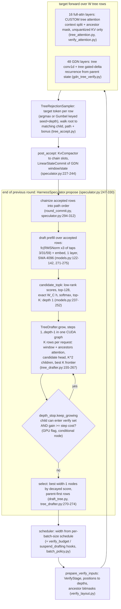

# EAGLE-4: draft architecture, decode round, verification, adaptive policy

Sources, labels and caveats are as in [overview.md](overview.md). Code paths are relative to `~/research-src/EAGLE-4` at `7b7b5a5`. This file follows the **vLLM adapter** (`eagle_harness/vllm/`) because we serve through vLLM. SGLang differences are noted where they matter.

## 1. The Qwen3.8-27B draft: config and size

Sources:
- The HF `config.json`, which is identical to `eagle_harness/core/profiles/mi355x-qwen3.8-27b-tp1/draft_config.json` (measured: diffed).
- The safetensors header, read with an HTTP range request. Every count below is **measured** from the header shapes.

| Item | Value |
|---|---|
| Architecture | `LlamaForCausalLMEagle4`, 1 decoder layer, `layer_types: ["sliding_attention"]`, `sliding_window: 4096` |
| Attention | MHA: 40 q heads, 40 kv heads, head_dim 128 |
| RoPE | `rope_theta` 1e7 |
| Width | hidden 5120 (same as the target) |
| q/k/v input | `[5120, 10240]`: the input is `cat(norm(embed), norm(fc(aux)))` (`eagle_harness/vllm/models.py:134-140`) |
| FFN | dense SiLU, intermediate 16384 (the target is dense, so the draft is dense, paper §3.4 p. 6) |
| Target features | `eagle_aux_hidden_state_layer_ids: [3, 31, 59]`; 3 taps, each RMS-normed (`fc_norm.{0,1,2}`), then `fc: [5120, 15360]` |
| Efficient head | `efficient_lm_head_config: {type: low_rank, rank: 128, num_candidates: 128}` |
| Vocab | full 248,320; `draft_vocab_size` = vocab, so there is no EAGLE-3 d2t truncation |
| Norms | `norm_output: true` (EAGLE-3.1 post-norm), `tie_word_embeddings: false` |

Parameter breakdown (measured from header shapes; BF16; 3,089,075,200 parameters in total):

| Tensor group | Params | BF16 bytes |
|---|---|---|
| Decoder layer: q, k, v 3×52.43M; o 26.21M; gate, up, down 3×83.89M; norms | 435.2M | 0.870 GB |
| `lm_head [248320, 5120]` (the draft's own) | 1271.4M | 2.543 GB |
| `embed_tokens [248320, 5120]` | 1271.4M | 2.543 GB |
| `fc [5120, 15360]` | 78.6M | 0.157 GB |
| `efficient_lm_head [248320,128]` + `efficient_lm_head_down_proj [128,5120]` | 32.4M | 0.065 GB |

- The paper's "0.44B per drafted position" (Table 1, p. 3) is the decoder layer alone: 435.2M.
- vLLM shares the target's embedding with the draft. [review: in stock vLLM 0.31.0 sharing happens only if the checkpoint has no `embed_tokens` or its tensor is `torch.equal` to the target's (`vllm/v1/spec_decode/llm_base_proposer.py:1416-1560`; MRV2 `v1/worker/gpu/spec_decode/eagle/utils.py:15-27`). The released checkpoint ships `embed_tokens`, and our target embedding is int8 `weight_packed` (ours `docs/optimizations.md:45-54`), so on our stack it would not be shared unless dropped from the checkpoint.] The code comment reads "The draft trains its own lm_head; the embedding is the target's (vLLM shares it)" (`eagle_harness/vllm/models.py:146-147`).
- So the resident draft is about **1.82B params ≈ 3.64 GB BF16** (estimated: 3089.1M − 1271.4M embed).
- **Whether the draft's `lm_head` equals the target's** is unchecked. If it does, sharing it would save 2.54 GB. See the open questions. [review: moot on our stack: the plugin sets `has_own_lm_head = True` (`models.py:147`), and our target lm_head is requantized (int8, or int4 GPTQ in the fast variant: ours `docs/optimizations.md:11-14`, `single-user/start_qwen.sh:14-16`), so a `torch.equal` share cannot fire.]

Hooks that check the config:
- `validate_eagle4_draft_config` (`eagle_harness/models/eagle4_config.py:167-252`) requires:
  - exactly 3 aux states
  - concat fusion
  - a `low_rank` or `weighted_low_rank` head
  - for a latent MoE: ReLU² and a sigmoid `noaux_tc` router
- `check_ported` (`eagle4_config.py:268-284`) allows a single layer only, requires the efficient head, and refuses a reduced vocab (d2t).
- The sliding-window semantics "as trained" (`eagle4_config.py:9-12`): "at draft depth d a query attends to at most W context keys ending at it plus the d draft tokens of its own chain".

### Dense against latent MoE

The paper finds that MoE "improves generalization across draft steps and context lengths, but increases memory requirements and training overhead". It matches the target's FFN type (§3.4, p. 6).

In code:
- `LATENT_MOE_ARCHITECTURE = "nemotron_latent_relu2"` (`eagle_harness/models/eagle4_structure.py:11`).
- vLLM builds a latent-MoE draft FFN as the target's own `NemotronHMoE` block (`eagle_harness/vllm/models.py:112-119, 192-201`).
- Qwen3.8-27B is dense, so its draft is dense and the MoE path does not concern us.

### Which target features it consumes

- Three hidden states, from target layers 3, 31 and 59 of 64.
- vLLM captures the *input* of layer i+1, so the plugin asks for layers 4, 32 and 60 (`eagle_harness/vllm/config.py:199-206`).
- They are combined by per-tap RMSNorm, then `fc` (`models.py:271-275`, `combine_hidden_states`).
- After the first draft step, the draft reuses its own hidden state (EAGLE-3 recurrence, paper §2.2 p. 5). It never sees new target states until the next verify.
- The plugin registers with `uses_target_hidden_states=True, uses_aux_hidden_states=True` (`eagle_harness/vllm/plugin.py:31-67`).

## 2. Efficient LM Head (candidate retrieval and exact rescoring)

- Paper (§3.2, pp. 5–6):
  - z̃ = A(Bh) with B ∈ ℝ^{r×d} and A ∈ ℝ^{V×r}.
  - C = TopK(z̃, K), then z_C = W_C h.
  - Cost goes from O(Vd) to O(dr + Vr + Kd).
  - Only A and B are trained; the rest of the drafter stays frozen.
- vLLM path (`eagle_harness/vllm/models.py:226-269`):
  1. `low_rank_scores`: `hidden @ down_proj.T @ score_head.T` over this TP shard's vocab rows, with −inf past the shard (`eagle_harness/models/low_rank_head.py:32-41`).
  2. `shard_topk`: the top `num_candidates` = 128 of the low-rank scores.
  3. `gather_dot`: the exact logits `W[ids] · h` over those 128 rows of the draft's own full `lm_head`.
  4. `candidate_tail`: merge across shards, softmax over the 128 candidates, top-k.
     - `candidate_topk` returns fp32 probabilities and ids of the top `node_top_k` (`models.py:237-252`).
     - `compute_logits` scatters the 128 into a −inf full-vocab row (`models.py:258-269`).
     - The draft distribution is therefore truncated to 128 tokens. This is harmless for correctness, because verification never reads draft probabilities (§5).
- SVD init with optional token-frequency weighting (`low_rank_head.py:44-98`).

What it buys on a 3090 (estimated):
- At batch size 1, a draft step is bound by memory traffic.
- The full head would read 2.543 GB per step.
- The low-rank path reads 0.065 GB of factors plus 128 rows × 5120 × 2 B = 1.3 MB. Per row-group that is about 5 MB at K = 4.
- Per step, with the 0.870 GB layer and about 0.084 GB of windowed draft KV (4096 tokens × 20 KiB), the total is:
  - about **1.02 GB** with the efficient head
  - about **3.50 GB** with a full head
  - That is a 71% cut.
- At the 3090's 936 GB/s peak the floor is ≈1.09 ms against ≈3.7 ms per draft step.
- This matches the direction of the paper's B300 figure: 574 → 255 µs, −55.6% (Fig. 2, p. 4).

## 3. Draft attention: sliding window and append-only cache

- Paper §3.3.1–3.3.2 (p. 6):
  - SWA, or DSA, limits the context each draft step reads.
  - New draft entries are appended during a drafting phase without evicting old ones. This "simplifies cache management".
- vLLM implementation (`eagle_harness/vllm/draft_attention.py:4-13`, `eagle_harness/vllm/tree_drafter.py:4-17`):
  - Draft step s runs K frontier rows per request, all at position c + s − 1, where c is the committed length.
  - Each row writes its draft KV into a scratch slot past c (`draft_step_slots`, `tree_drafter.py:172-180`).
  - Each row attends to:
    - the committed draft KV inside the window
    - its own s tree ancestors (`DraftTree.ancestors`)
  - The kernel (`eagle_harness/kernels/row_attention.py`) loads each committed key **once for all K rows** of a request with a `tl.dot` over the rows, so the K-way tree costs about one row's KV traffic.
  - The window is cut "into about one program per SM" (`draft_attention.py:39-44`).
- After verification, a draft prefill over the accepted path overwrites the scratch with chain-position KV (`round_commit.chainize`, `eagle_harness/vllm/speculator.py:294-313`). That is the "append-only" part: the committed draft KV is only ever extended.
- Paging constraints:
  - Draft KV per token is 1 layer × 2 × 40 × 128 × 2 B = **20 KiB**. The target's 16 full-attention layers take 16 × 2 × 4 × 256 × 2 B = **64 KiB** in BF16 (estimated from the configs).
  - If vLLM keeps out-of-window draft blocks, the draft adds about 31% to the BF16 KV per token. If it frees them, the draft holds at most 80 MiB per request. Which one happens on our pin is an open question.
  - vLLM chain mode must run the draft on `FLASH_ATTN`: "FlashInfer cannot serve the multi-head EAGLE-4 draft on the 128-token pages a hybrid target needs" (`docs/configuration.md:95-98`).

## 4. Drafting procedure: tree growth, depth and width

The core tree is shared by SGLang and vLLM (`eagle_harness/core/draft_tree.py:4-25`):
- The root, the last accepted token, has score 1.001 (`ROOT_SCORE`, `draft_tree.py:35`). Its K children come from the draft prefill's top-k, and they form depth 1.
- Each step expands the K frontier nodes. Every node yields its top-K children, scored parent × child probability.
  - All K² children join the tree.
  - The best K of them become the next frontier.
- The verify set is the best `count` nodes by **depth-decayed** score, `DEPTH_DECAY**d` with `DEPTH_DECAY = 0.9999` (`draft_tree.py:36`). The decay orders a parent before an equal child.
  - Rows are emitted parent-first, so **any prefix of the verify rows is itself a tree** (`eagle_harness/vllm/verify_layout.py:13-15`).
  - The scheduler may therefore grant fewer rows than were drafted.
- Shapes:

  | Shape | Default | Hard limit |
  |---|---|---|
  | `node_top_k` (K) | 8 (`eagle_harness/vllm/config.py:68`) | 8 (`core/limits.py:26`) |
  | `tree_depth` | 12 (`config.py:69`) | 31 for a tree, 15 for a chain (`limits.py:24-25`) |
  | `max_verify_width` | 32 for trees, 16 for chains | 64 for trees, 16 for chains (`limits.py:28-30`) |

  - The verify width limit of 64 exists because the ancestry mask is one uint64 per row (`limits.py:27`).
  - Chain = `node_top_k == 1`.
  - The repo's vLLM recipe uses K = 4, depth 14, width 16 (`docs/quickstart-vllm.md:61`).
  - The paper uses 12-4-16 at C1 and 15-1-16 at C512 (p. 7).
- **Depth stop on vLLM** (`eagle_harness/vllm/depth_stop.py:4-27`). After step s, step s+1 runs only if both conditions hold:
  - `max(front) · decay ≥ threshold`. Here `threshold` is the decayed score of the `count`-th best node, so some child could still enter the verify set.
  - `Σ relu(front · decay · ratio − threshold) ≥ min_gain + step_share · expected`.
    - `step_share = draft_step / (rest + s · draft_step)` comes from measured cost tables.
    - `ratio` estimates the next child's probability from the last layer.
  - Across a batch, a step runs if any request wants it.
  - The decision is a GPU scalar that a **CUDA-graph conditional node** reads, so the whole growth replays as one launch with no host sync (`tree_drafter.py:186-207`, `begin_capture_to_if_node`).
- **Width on vLLM** is not chosen per round. "vLLM's scheduler fixes the verify width of a step from the batch size" (`speculator.py:22-26`).
  - The plugin writes `num_speculative_tokens_per_batch_size` from a measured `rounds/tree.json` (`config.py:209-264, 290-301`).
  - With the post-0.1.0 hooks, `BatchPolicy` trims each batch to its width. In the "native-OFF" ranges it suspends drafting entirely (`eagle_harness/vllm/batch_policy.py:32-35, 53-95`).
- **SGLang** decides the verify width per round, after every second level, from live CUDA-event costs (`docs/architecture.md:52-89`, `docs/calibration.md`). This is the full paper algorithm. vLLM gets a static-width approximation.

The packaged vLLM schedule (`eagle_harness/core/profiles/vllm-qwen38-tp4/rounds/tree.json`; repo-reported; 4×B300 TP4):

| Batch | Width | Round time | Accept per round |
|---|---|---|---|
| 1 | 4 | 5120 µs | 3.39 |
| 1 | 16 | 5809 µs | 8.68 |
| 64 | 4 | 13,935 µs | 2.82 |
| 64 | 16 | 36,474 µs | 4.92 |

The schedule picks width 16 below batch 20 and width 4 from batch 20 (`docs/quickstart-vllm.md:49-50`). At batch 1, a 16-row tree costs only 13% more round time than a 4-row tree but accepts 2.6× as much. On a GPU where verify cost per row is not flat, that trade changes. That is the point of the harness.

## 5. Verification and losslessness

- **Target forward over the tree**:
  - The verify rows' positions become depths (`verify_layout.py:4-11`).
  - Full-attention layers run `TreeFlashAttentionImpl`. Every row attends to the committed paged context plus its own ancestors, through an int64 ancestor bitmask per row (`eagle_harness/vllm/tree_attention.py:4-16`, `eagle_harness/vllm/verify_attention.py:4-11`).
  - The context is split across SMs, and a log-sum-exp merge follows.
  - **Quantized KV is refused**: `raise NotImplementedError("tree verify needs an unquantized KV cache")` (`tree_attention.py:69-70`).
- **GDN layers** run the tree through vLLM's `LinearAttnVerifyExtension` (`eagle_harness/vllm/gdn_tree_verify.py:4-26`):
  - A width-4 causal conv gathers each row's three earlier inputs through the ancestor table, not the preceding rows.
  - The gated-delta recurrence starts each row from its **parent's** state slot. Row 0 starts from `slots[b, num_accepted−1]`.
  - This keeps vLLM's chain layout of one recurrent-state row per verify row.
  - Any linear-attention layer type not handled is refused (`check_tree_verifiable`, `gdn_tree_verify.py:148-163`).
- **Accept** (`eagle_harness/vllm/tree_accept.py:4-22`):
  - Every verify row gets the target's own draw. For greedy this is the argmax. For sampling it is vLLM's Gumbel-max with noise keyed by (request seed, row depth), after temperature, top-k, top-p, min-p and logit bias.
  - The walk goes from the root to the child whose draft token equals the current node's target token, and stops where no child matches. The last path row's token is the bonus.
  - This is "target-sample-then-match", not ratio rejection sampling. It is lossless for any deterministic draft tree: "The draft tree must be fixed before the noise is drawn, which holds: the harness drafts deterministic top-k trees" (`tree_accept.py:16-17`).
  - At T > 0 it accepts less than ratio-based tree rejection would, because draft probabilities are unused. This is estimated from the rule itself and not measured.
- **Paper on T > 0** (§3.1, p. 5): "stopping on the tokens drawn in the current round would bias the output distribution". The harness "fixes the depth of each sampled round in advance, using the depth at which the previous round would have stopped".
- **Fallbacks**:
  - Batches with penalties, bad words or a thinking budget are verified as chains (`speculator.py:14-16, 205-206`).
  - A grammar-constrained batch emits only the root token per round (`docs/known-limits.md`, Requests).
- **After acceptance** (`eagle_harness/vllm/round_commit.py:4-14`):
  - `KvCompactor` copies the accepted rows' target KV to chain slots.
  - `LinearStateCommit` moves the conv window and the last accepted row's recurrent state into chain order (`gdn_tree_verify.py:24-26`).
  - `chainize` rewrites the draft-prefill inputs into path order.
- **Greedy parity in practice**:
  - Shape-dependent numerics cause divergences at near ties.
  - The repo's gate accepts a first-divergence logprob gap ≤ 0.13 as a near tie. Larger gaps go to fp32 arbitration.
  - "Passing either rule is not bitwise equality to the native BF16 token stream" (`docs/support-matrix.md:159-163`; tool `tools/fp32_arbiter.py`).

### Mermaid: one vLLM tree-mode decode round

## 6. The adaptive strategy across batch sizes and hardware

- **One rule, three points** (paper §3.1, p. 5; Algorithm 1, p. 6). This is the paper's own description.
  - Depth: ΔA_d / c_draft ≥ τ_d, with τ_d rising with depth.
  - Verify count: add node n+1 while p̂_{n+1} / (c_ver(n+1) − c_ver(n)) ≥ τ_v.
  - Branching: up to 8 per node when lightly loaded, at most 4 when heavily loaded. Load is read from the profiled cost of verifying a fixed token count.
  - The configured defaults include a cost-model threshold of 2.5, `depth_loss_ratio` 0.04 for eagle4 (doubled for MoE targets) and `async_layer_ratio` 0.9 (`docs/configuration.md`; `eagle_harness/core/cost_model.py:89-97`).
- **Where costs come from**:
  - SGLang: live CUDA-event timings, an EMA per (batch bucket × verify width × 1024-token context interval).
    - Cached at `~/.cache/eagle-harness/costs/<key>.json`.
    - Keyed by GPU, TP, config digests, engine and dtype (`docs/calibration.md`; `eagle_harness/core/live_costs.py:36-110`).
  - vLLM: an offline `eagle-harness calibrate` at batch 1, widths 8/16/32/64, with context under 4096.
    - It produces cost tables for the depth stop and a `rounds/tree.json` for the width schedule.
    - A sanity rule requires the target/draft cost ratio to be 5..100 (`docs/calibration.md`).
    - Since `e9baddd`, data measured on another setup is refused (`config.py:304`, `check_data_key`).
- **Chain width rule** (`docs/calibration.md:170-190`; `eagle_harness/core/chain_width.py:108-128`):
  - Maximise (1 + a_1 + … + a_{w−1}) / (V(B, w) + (w − 1) · D(B)).
  - a_i are the per-position acceptance counters, V is the verify cost and D is the draft-step cost.
  - Width 0 means "native-OFF": the method is off at that batch size.
- **What adapts**:
  - Small batch: a deep, wide tree. Paper 12-4-16; repo vLLM 14-4-16.
  - Large batch: a short chain. Paper 15-1-16 at C512 (p. 7); repo width 4 from batch 20.
  - Above the break-even point: off.
  - The weights stay the same. Only the tables change per GPU, TP and dtype.

## 7. What this means on one 3090 (estimated)

- **Draft cost against target cost.**
  - Per bandwidth-bound step, the BF16 draft reads about 1.02 GB (§2), a floor of ≈1.1 ms.
  - A depth-6 round is about 6.2 GB of draft traffic, ≈6.6 ms: the prefill (layer + fc + factors ≈ 1.09 GB) plus 5 steps.
  - Compare our MTP drafter: int4 GPTQ (`single-user/start_qwen.sh:14`), roughly 0.2 GB per step. [review: ≈0.32 GB: 215 MB int4 module plus ≈0.11 GB int4 40,960-row head (ours `single-user/start_qwen.sh:14-16`); see 00-meta/reviews/phase1-eagle4-architecture-calc.out.]
  - The harness's own depth rule would therefore keep 3090 trees much shallower than B300's 12–15 unless the draft layer is quantized.
  - W4A16 on the layer would be ≈0.22 GB plus scales, so ≈0.4 ms per step.
- **GDN state per verify row.**
  - 48 GDN layers × 48 value heads × 128 × 128 × 4 B ≈ **144 MiB per row at fp32** (`mamba_ssm_dtype: float32` in the target config), or 72 MiB at 16-bit.
  - A width-16 tree needs 16 rows per request, about 2.25 GiB at fp32. That equals vLLM's 15-token chain verify in the same layout (`gdn_tree_verify.py:8-11`). So it is no worse than our `DFLASH_TOKENS=15` mode C, but expensive beside MTP's few rows. [review: our stack runs `--mamba-ssm-cache-dtype float16` (ours `single-user/start_qwen.sh:1036`), and the EAGLE-4 GDN kernels accept a fp16 state (`gdn_tree_verify.py:245`). The relevant figure is 72 MiB/row: ≈1.1 GiB for 16 rows, ≈1.2 GiB with align mode's 2+k slots (ours `start_qwen.sh:566-575`).]
  - Overlaps deepinfer spec-3 (RecoverSSM).
- **Verify width.** Our DFlash2 mode already verifies 15 tokens per step (`README.md:112` in our repo). A 16-row tree verify costs about the same target time, if the attention kernel can do a tree mask over our KV format.
- **Quantized KV.**
  - Our modes D and E use fp8, `int8_per_token_head` or KVarN KV (`single-user/start_qwen.sh:218-250, 346`). EAGLE-4's vLLM tree verify refuses all of them (`tree_attention.py:69-70`).
  - Only a BF16-KV mode, or a port of the ancestor mask into our pthfa or KVarN kernels, can verify trees. Chain mode has no such limit.
- **Backend-name clash.** Our `PTH_FA=1` already binds `--attention-backend CUSTOM` to pth-flash-attn (`single-user/start_qwen.sh:346`), and EAGLE-4 binds `CUSTOM` to `TreeFlashAttentionBackend` (`plugin.py:31-67`). They cannot coexist without renaming one. [review: renaming needs a vLLM patch: `CUSTOM` is the only enum member reserved for plugins (ours `pthfa/python/pth_flash_attn/plugin.py:13-18`). EAGLE-4 overwrites it unconditionally; pthfa yields if already taken. Load order decides. Moot for tree mode in practice: `PTH_FA=1` forces `int8_per_token_head` KV, which tree verify refuses.]

## Candidate techniques

- **E-10** Low-rank candidate head (rank 128, K = 128) with exact rescoring, in front of our drafter's lm_head. It replaces the 40,960-row draft-vocab slice (`docs/third-party-checkpoints.md:50`) and keeps the full vocabulary. Training is pilot P-a in training-recipe.md. Overlaps deepinfer quant-5 (lm_head cost).
- **E-11** Per-tap RMSNorm 3-tap fusion (target layers 3/31/59) plus a sliding-window draft attention (W = 4096). These bound draft cost at long context; the paper reports a flat 5.57–6.04 ms round from 32K to 250K context (paper-reported, Table 7 p. 10).
- **E-12** Device-side depth stop: a GPU flag that a CUDA-graph conditional node reads (`depth_stop.py`, `tree_drafter.py:186-207`). It skips draft steps without a host sync. Overlaps deepinfer spec-2 and drafter-1.
- **E-13** Per-batch-size verify width from measured round tables, including a native-OFF range (`chain_width.py`, `batch_policy.py`). Overlaps deepinfer spec-0, spec-1 and runtime-2.
- **E-14** Tree verify on the GDN target: tree conv1d plus a recurrence that starts each row from its parent's state, then a state commit. Overlaps deepinfer spec-3 for state residency.
- **E-15** Target-sample-then-match tree acceptance with Gumbel noise keyed by (seed, depth). It is lossless for any deterministic top-k tree, needs no draft probabilities, and works with a truncated-candidate draft.
- **E-16** Parent-first verify-row order, so any prefix is a valid tree. This lets a scheduler trim the verify budget per step without redrafting. Overlaps deepinfer spec-2.
- **E-17** Row attention that loads each committed key once for all K draft rows (`kernels/row_attention.py`). This makes a K-wide draft tree cost about one row of KV traffic.
- **E-18** Near-tie plus fp32-arbiter greedy-parity gate (`tools/fp32_arbiter.py`, `docs/support-matrix.md:159-163`) as the correctness check for any non-bit-exact speculative change.
