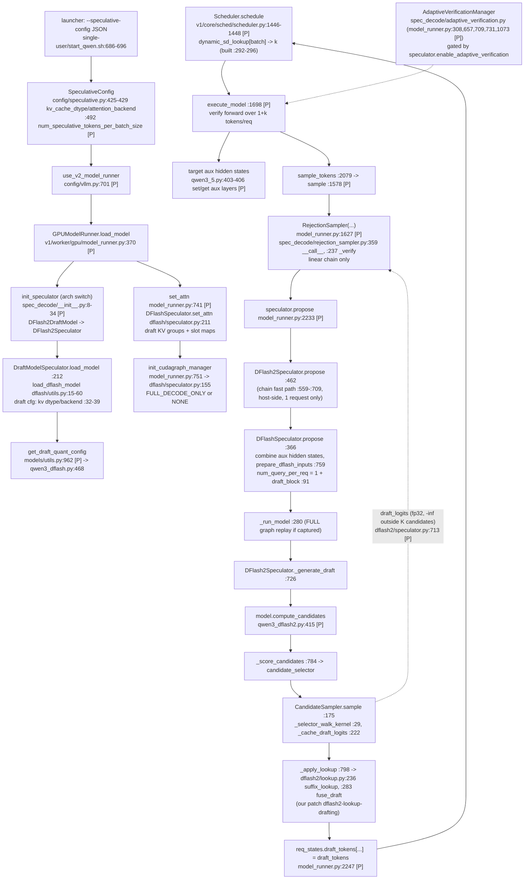
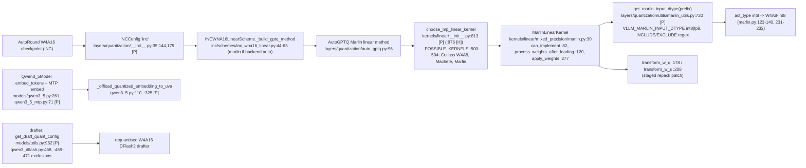
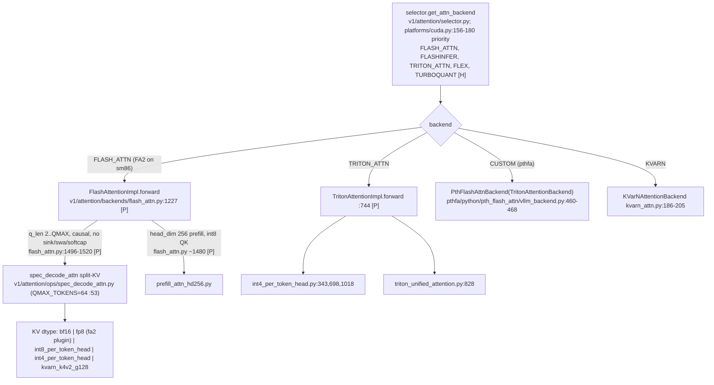

# vLLM integration paths for the Qwen3.8-27B / RTX 3090 stack

Author: vllm-tracer (read-only trace, no GPU). Branch `research/eagle4-expedition`. Scope: where our patched vLLM runs speculative decode, quantisation, attention, KV cache and CUDA graphs, and where an EAGLE-4 style change would plug in.

## 0. Conventions

- `[P]` = the tree this project serves: vLLM **0.31.0** (`docker/requirements.txt:5` [review: was `:6`; the pin is on line 5]), plus `patches/series` (51 patches, measured: `grep -v '^#' patches/series | grep -c .`), plus the four KVarN patches and `kvarn/files` (`Dockerfile:42-51`, `patches/apply.sh`). Rebuilt for this trace as `git -C ~/vllm archive v0.31.0 vllm`, then `bash patches/apply.sh <dir>` and `bash kvarn/install.sh`; every patch and the four KVarN patches applied cleanly at fuzz 0 (measured). Line numbers marked `[P]` are in that rebuilt tree.
- `[H]` = `~/vllm` HEAD `4bd75e952a` (`v0.32.1rc0-68`). Pristine, read-only.
- Paths are relative to the `vllm/` package directory unless they start with `~` or a project directory.
- **measured** = a command output I ran (git, patch dry-run, grep, sed). **estimated** = my reasoning, always with the reason.
- Our patches' line anchors are the first-hunk function in the final `[P]` tree, so later patches in the stack shift them by a few lines from the numbers inside the `.patch` file.

## 1. Version map (ours vs `~/vllm`)

| Item | Ours `[P]` | `~/vllm` `[H]` | Evidence |
|---|---|---|---|
| Release | 0.31.0 (`db9527a468`, 2026-10-02) | 0.32.1rc0-68 (`4bd75e952a`, 2026-10-19) | `git log -1 v0.31.0`, `git describe` (measured) [review: plain `git describe` prints `proto-v0.6.0-328-g4bd75e952a`; the `v0.32.1rc0-68` name needs `git describe --tags --match 'v*'`] |
| Distance | 0 | **1262 commits** ahead; 1411 files, +132,523/-43,893 lines under `vllm/` | `git rev-list --count v0.31.0..HEAD`, `git diff --stat v0.31.0 HEAD -- vllm` (measured) [review: v0.31.0 is **not** an ancestor of HEAD; it sits on a release branch with 27 commits HEAD lacks (`git rev-list --count HEAD..v0.31.0`), merge-base `3d5f4d4cd5`. The 1262 count is correct as "commits in HEAD not in v0.31.0"] |
| EAGLE-4 host base | not an ancestor | `074c83a09a` (the EAGLE-4 vLLM base, `~/research-src/EAGLE-4/eagle_harness/compat.py:54`) **is** an ancestor of HEAD: 155 commits behind HEAD, 1107 after v0.31.0 | `git merge-base --is-ancestor`, `git rev-list --count` (measured) |
| Model runner | V2 for DFlash2/MTP (`VLLM_USE_V2_MODEL_RUNNER`, `config/vllm.py:701-740` `[P]`) | same property at `config/vllm.py:707-772` `[H]` | read |
| V2 refuses | `ngram`, `ngram_gpu`, `suffix`, `medusa`, `mlp_speculator`, `custom_class` (`config/vllm.py:3074-3082` `[P]`) | only `suffix`, `custom_class` (`config/vllm.py:3030` `[H]`); ngram has a V2 speculator (`v1/worker/gpu/spec_decode/ngram/`) | read |
| Speculator factory | `v1/worker/gpu/spec_decode/__init__.py:8-65` `[P]` | `__init__.py:13-88` `[H]`; adds `DFlash2BeamDraftModel`, `ngram`, `standalone_ar`, `target_dependent_ar` [review: the file has 88 lines, not 110; `LiLiCorr` is already in `[P]` (`__init__.py:18-23` `[P]`), so it is not a HEAD addition] | read |
| `target_dependent_ar/` | absent | present (`spec_decode/target_dependent_ar/`, `EagleSpeculator` derives from it, `eagle/speculator.py:12` `[H]`) | `git ls-tree -r v0.31.0`, `ls` (measured) |
| KV shape API | per-backend (`get_kv_cache_shape`) | removed. Layout comes from the layer spec plus `KVCacheLayout` (`v1/kv_cache_layout.py:15-27` `[H]`) and `AttentionBackend.customize_spec` (`v1/attention/backend.py:138` `[H]`), `supported_kv_cache_layouts` (`backend.py:369` `[H]`) | read; the KVarN port notes say the same for 0.29 (`kvarn/README.md`, "0.29.0" bullet) |
| KV planning | `v1/core/kv_cache_utils.py` (our hunks at 1381-1644) | `kv_cache_utils.py` shrank to +186/-1916 lines; planning moved to `v1/core/kv_cache_planning.py` | `git diff --numstat` (measured) |
| Triton KV dtypes | `int4_per_token_head`, `int8_per_token_head`, `fp8_per_token_head` all upstream already [review: was "int4 is our patch"; pristine v0.31.0 has them at `config/cache.py:53-55` and `triton_attn.py:301-303`, and ships `ops/int4_per_token_head.py`; our `int4-kv-per-token-head` only fixes three boot blockers (17 added lines)] | `int4_per_token_head`, `int8_per_token_head`, `fp8_per_token_head` all upstream (`v1/attention/backends/triton_attn.py:324-334`, `config/cache.py:54-55`, `v1/kv_cache_interface.py:91-110` `[H]`) | read |
| Tree attention | removed (#42121, `b1728c1e66`, 2026-05-08, ancestor of 0.31.0) | removed | `git merge-base --is-ancestor b1728c1e66 v0.31.0` (measured); no `tree_attn*` file in either tree |
| Speculative-method registry (`register_speculative_method`, `SpeculativeMethodSpec`) | 0 hits | **0 hits** | `git grep` in v0.31.0 and `grep -rl` in HEAD (measured) |
| Our series on HEAD | n/a | **18 of 51 apply, 33 fail** (each patch dry-run alone against pristine HEAD) [review: re-measured with both `patch --dry-run -F0` and `git apply --check` on all 51: same 18/33. But 11 of the 33 also fail alone on pristine **v0.31.0** because they stack on earlier series patches (`qwen3_5-mtp-draft-vocab`, `spec-decode-int8-kv`, `dflash2-ngram-chains`, `prefill-attn-int8`, `spec-decode-scratch-token-units`, `spec-decode-scratch-within-budget`, `dflash2-z-adaptive-emitted`, `triton-spec-attn-fp8-kv`, `spec-attn-smem-fit`, `api-root-health`, `qwen3_5-embed-uva`), so only 22 failures are proven HEAD context drift; the other 11 are undetermined until their parents are re-cut] | `patch --dry-run -p1 -F0` per patch (measured; list in section 6) |

Reading of the table: an EAGLE-4 plugin cannot run on 0.31.0 even in principle (no registry, no `target_dependent_ar`, no GDN verify hook), and our series cannot move to HEAD without re-cutting about two thirds of it. Both facts point at one decision: "rebase our patches onto a 0.32 base" is a prerequisite for anything that uses EAGLE-4's own code. See section 9.

## 2. Spec-decode path

Our default is `SPEC=dflash2` (V2 runner, `DFlash2DraftModel` checkpoint, 1 bonus + N mask query layout in one non-autoregressive pass). `SPEC=mtp` is the second profile. The launcher builds the JSON at `single-user/start_qwen.sh:394` (dflash2) and `:666` (mtp), and appends `DYNAMIC_K` at `:683-694` [review: was `:697-701` / `:686-696`, which are the prefix-cache comment and the DYNAMIC_K block].

Every `[P]` line in the graph is a measured location in the rebuilt tree. Notes that matter for integration:

1. **One query layout.** `num_query_per_req = 1 + draft_block` (`v1/worker/gpu/spec_decode/dflash/speculator.py:91` `[P]`), and DFlash refuses `sample_from_anchor` (`:106-114` `[P]`). A drafter that emits a tree or a different per-request width does not fit this layout without touching `prepare_dflash_inputs` (`:759` `[P]`, `_prepare_dflash_inputs_kernel` `:557`).
2. **Verification is linear.** `RejectionSampler._verify` (`spec_decode/rejection_sampler.py:237` `[P]`, `:250` `[H]`) accepts a prefix of each request's draft chain. There is no parent array and no ancestor mask anywhere in the V2 path (measured: no `tree_attn*` file; the `#42121` removal commit message is "Remove tree attention").
3. **Hidden states.** The target hands the drafter EAGLE3-style aux hidden states: `Qwen3_5ForCausalLM.set_aux_hidden_state_layers` / `get_eagle3_aux_hidden_state_layers` (`model_executor/models/qwen3_5.py:403-406` `[P]`; `models/interfaces.py:1562-1599` `[P]`). `DFlashSpeculator.propose` concatenates them and calls `model.combine_hidden_states` (`dflash/speculator.py:~395-410` `[P]`, `:435-470` `[H]`).
4. **Existing seams** (all measured present in `[H]`; the first four also in `[P]`):
   - `model_state.custom_sampler(self.sampler)` returns `(sampler, rejection_sampler)`: `model_runner.py:484` `[P]`, `:507-513` `[H]`. This is the one place a different acceptance rule can be installed without editing the runner's `sample`.
   - `init_speculator` arch/method switch (`spec_decode/__init__.py`).
   - `DraftModelSpeculator.load_draft_model` / `set_attn` / `_build_attn_metadata` (`spec_decode/speculator.py:207,274,298` `[P]`).
   - `num_speculative_tokens_per_batch_size` (k per batch-size range, k may be 0; values `>= 0` enforced at `v1/spec_decode/dynamic/utils.py:~54` `[H]`).
   - `AttentionBackend.update_draft_decode_metadata` (`v1/attention/backends/triton_attn.py:300` `[H]`) for per-draft-step metadata.
   - `CandidateSampler` (`dflash2/speculator.py:152` `[P]`, `:111` `[H]`) is the shared candidate walk; our lookup patches sit on it.
5. **Dynamic k.** `Scheduler.__init__` builds the dense lookup (`scheduler.py:292-296` `[P]`), `schedule` reads it per step (`:1446-1448` `[P]`; `:307-312`, `:1565-1570` `[H]`), and `CudaGraphManager._init_candidates` captures one graph set per distinct query length (`v1/worker/gpu/cudagraph_utils.py:268-290` `[P]`; `:256-395` `[H]`). The launcher exposes it as `DYNAMIC_K` (`single-user/start_qwen.sh:692`). The project's own comment reports +7.7%, +8.0%, +9.2% decode at 4 streams in three A/Bs and single-stream within 1% (`single-user/start_qwen.sh:679` [review: was `~672-675`]; **project-reported, not re-measured by me**) and refuses it at `CTX=huge` with prefix caching on (`:682-690`).
6. **GDN state rollback for a rejected chain.** GDN keeps one recurrent-state slot per draft token (`model_executor/layers/mamba/abstract.py:79-83` `[P]` sets `num_speculative_blocks=num_speculative_tokens`; `[H]` `abstract.py:86-90` sets it to 0 only when `use_replayssm`). The fused kernel starts from slot `num_accepted_tokens - 1` (`third_party/flash_linear_attention/ops/fused_sigmoid_gating.py:106` `[P]`, `:105-106` `[H]`; our `vllm-pr50021-gdn-spec-bounds` adds the bounds comment/guard at `:110`). The call sites are `layers/mamba/gdn/qwen_gdn_linear_attn.py:1448,1475` `[P]` (`:1757-1771` `[H]`). `RecoverSSMState` (`v1/worker/gpu/model_states/mamba_hybrid.py:29,95` `[H]`) is gated on `use_kda_recoverssm`, a KDA feature; it does not apply to Qwen GDN (**estimated** from the gate name and the single call site; I did not trace KDA).
7. **Async scheduling and the lookup.** Several patches depend on the speculator being called from `sample_tokens` after the rejection sampler; `DFlash2Speculator.propose` keeps its chain state machine on the host precisely because `propose` is never captured (`dflash2/speculator.py:462-560` `[P]`, comment at `:481-484`).

## 3. Quant path

- **Target weights.** W4A16 through AutoRound (INC) to AutoGPTQ-Marlin. `INCWNA16LinearScheme._build_gptq_method` picks Marlin when `layer_config.backend` is `auto` or contains `marlin` (`model_executor/layers/quantization/inc/schemes/inc_wna16_linear.py:53-63` `[P]`, same lines `[H]`).
- **W4A8-int8.** Selected per layer by `get_marlin_input_dtype(prefix)` (`marlin_utils.py:720-742` `[P]`). Our `marlin-int8-layer-select` adds the include/exclude regexes (`envs.py:200-202` `[P]`: default exclude `lm_head|mtp`). `marlin-int8-negative-scales` and `marlin-int8-asym-zp` change `MarlinLinearKernel.process_weights_after_loading` (`marlin.py:120-145`, `:231-232` `[P]`) and `apply_gptq_marlin_linear` (`marlin_utils.py:762` `[P]`). The fp8 activation variant raises unless the device is sm89 or sm12x (`marlin_utils.py:735-742` `[P]`), so **it is closed on sm86**; int8 is the only act-quant route on this card.
- **Embedding / lm_head.** `qwen3_5-embed-quant` passes `quant_config` to the token embedding (`qwen3_5.py:261`, `qwen3_5_mtp.py:71`); `qwen3_5-embed-uva` keeps the quantised embedding in pinned host RAM behind a UVA view (`qwen3_5.py:110,325`; project-reported 1.25 GiB VRAM saved, `PATCHES.md`, **not re-measured**).
- **Drafter quantisation.** The DFlash family loads its draft with `get_draft_quant_config(vllm_config)` (`models/utils.py:962` `[P]`; `:985-1007` `[H]`), which builds the draft's own `QuantizationConfig` from the draft `ModelConfig`; `qwen3_dflash.py:468` `[P]` (`:444` `[H]`) stores it and `_add_global_draft_layer_exclusions` (`:469-471` `[P]`, `:446` `[H]`) keeps the non-decoder layers in 16-bit. The EAGLE3 family uses the same helper (`models/qwen3_eagle3.py:44,168,311` `[P]`; [review: the class EAGLE-4 subclasses is `llama_eagle3.Eagle3LlamaForCausalLM` (`eagle_harness/vllm/models.py:43,145`), which calls the helper at `llama_eagle3.py:108,177,332` `[P]`, including its own `lm_head`]), so an EAGLE-4 drafter built on `Eagle3LlamaForCausalLM` inherits drafter quantisation for free. Our `dspark-draft-quant-config` handles a bf16 drafter beside a quantised target (`models/utils.py:~979-983` `[P]`: return `None` when the draft has no `quantization_config`).
- **sm86 facts.** Marlin W4A16 needs sm80+ and runs on sm86 (this is the stack's baseline). `marlin-repack-staged-sm80` is a memory-peak fix for the sm80 repack (`marlin.py:178` `[P]`). Cutlass W4A8 and Machete rank above Marlin in `_POSSIBLE_KERNELS` (`kernels/linear/__init__.py:500-504` `[P]`) but are sm90 kernels (**estimated** from the kernel names; I did not read their `can_implement`), so Marlin wins on this card.

## 4. Attention / KV path

- **Stock FlashAttention fp8 KV is closed on sm86.** `flash_attn_supports_kv_cache_dtype` returns true only for FA3 or FA4 on sm90 (FA4 with head_size 512 only), or FA4 on sm100 (`v1/attention/backends/fa_utils.py:282-312` `[H]`), and `FlashAttentionBackend.supports_kv_cache_dtype` calls it for any quantised dtype (`flash_attn.py:433-440` `[H]`). Our `fa2/` plugin re-registers `FLASH_ATTN` with a fp8-KV FA2 build (`fa2/python/fa2_fp8kv_vllm/__init__.py:5-10`, `backend.py:137`).
- **Triton backend** accepts `fp8`, `fp8_e5m2`, `int4_per_token_head`, `int8_per_token_head`, `fp8_per_token_head` (`triton_attn.py:324-334` `[H]`), and its `customize_spec` packs the per-token-head scales inline (`:306-321` `[H]`). Our `spec-decode-int8-kv`, `int4-kv-per-token-head`, `spec-decode-int4-kv-mq3d`, `spec-decode-scratch-*` patches sit in `triton_attn.py` (`Mq3dScratchPlan:97`, `TritonAttentionMetadataBuilder.__init__:285`, `build:378`, `TritonAttentionImpl.__init__:637`, `forward:744` `[P]`) and in `ops/int4_per_token_head.py` (`_attn_packed:343`, `_launch_packed_attn:698`, `unified_attention_int4:1018` `[P]`).
- **Verify attention** is where speed is won on a 3090: a 5-8 query verify on stock FA2 leaves most of the 82 SMs idle. The docstring of our kernel gives the reason (`spec_decode_attn.py:4-12` `[P]`, project-reported: 24 FA or about 8 Triton blocks for MTP k=4, 57 us for a 1.5k context) and the cap `QMAX_TOKENS = 64` (`:53`), with restrictions "q_len <= QMAX_TOKENS, D a power of two <= 256, no sliding window / softcap / alibi" (`:40-41`). The kernel is **linear-causal**: query token `i` sits at KV position `seqused_k - q_len + i` and attends causally (`:21-22` [review: was `:33-35`]). A tree mask does not exist in it.
- **Custom slot.** `AttentionBackendEnum.CUSTOM` is one unbound enum member (`v1/attention/backends/registry.py:155-166` `[P]`). pthfa binds it and refuses to overwrite an existing binding (`pthfa/python/pth_flash_attn/plugin.py:30-45`). EAGLE-4 binds the same slot (`~/research-src/EAGLE-4/eagle_harness/vllm/plugin.py:58`). **Clash**: only one of the two can be active in a process (see section 8).
- **Backend selection for the drafter.** `speculative_config.attention_backend` and `speculative_config.kv_cache_dtype` override the target's choice for the drafter (`config/speculative.py:382-383`, `:425-429` `[P]`; consumed at `v1/worker/gpu/spec_decode/dflash/utils.py:32-39` `[P]`). That is the existing hook for a drafter KV dtype that differs from the target's (the launcher uses it: `single-user/start_qwen.sh:283`).
- **Layout.** `[H]` has no `get_kv_cache_shape` for FA/Triton; layout is `KVCacheLayout` (`v1/kv_cache_layout.py:15-27`) negotiated through `supported_kv_cache_layouts` (`backend.py:369`). The KVarN backend already declares `LBNHC` for this reason (`kvarn/README.md`, 0.29.0 bullet). A KV dtype change on `[H]` goes through `customize_spec` (`backend.py:138`, `triton_attn.py:306`), on `[P]` it still goes through the old per-backend shape path.
- **KV groups and hybrid pages.** GDN layers and attention layers have different page sizes; our patches `hybrid-kv-groups-v2-cudagraph` (`v1/core/kv_cache_utils.py:1599,1644` `[P]`) and `hybrid-sw-block-promote` (`:1381,1523`) fix group sizing when the drafter's sliding-window layers form the smallest bucket. `mamba-align-checkpoint-order` and `mamba-chunked-prefill-align` patch `MambaManager` (`v1/core/single_type_kv_cache_manager.py:1492-2073` `[P]`) and `preprocess_mamba_align_fused_kernel` (`v1/worker/mamba_utils.py:504`). `[H]` moved this to `kv_cache_planning.py`, which is why the KV-group patches fail there.

## 5. CUDA graphs

- **Owner.** `CudaGraphManager` (`v1/worker/gpu/cudagraph_utils.py:143` `[P]`); the speculator has its own manager (`DFlashCudaGraphManager`, `dflash/cudagraph.py`) created at `DFlashSpeculator.init_cudagraph_manager` (`dflash/speculator.py:155-180` `[P]`, `:143-167` `[H]`): FULL_DECODE_ONLY when the draft attention backend supports uniform-batch graphs, else NONE ("PIECEWISE cudagraphs are not supported for dflash", `:162-164` `[H]`). Capture: `model_runner.capture_model` (`:1024` `[P]`) calls `speculator.capture()` (`:1072`).
- **One graph set per verify length.** `_init_candidates` builds the capture candidate list per token count and per `decode_query_len` (`cudagraph_utils.py:250-335` `[P]`). With dynamic k it captures `{num_spec + new_sampled}` for every distinct k in the schedule (`:268-290`). Our `VLLM_DFLASH2_GRAPH_BOTH` adds the drafter's short block length beside the full verify length (`:296-313` `[P]`). Varlen decode graphs (adaptive verification) take any mix of 1..`decode_query_len` tokens per request (`:326-333`).
- **Graph memory.** `cudagraph-memory-from-allocator` measures captured graph memory by allocator-reserved bytes (`cudagraph_utils.py:425`, `model_runner.py:1024` `[P]`); the launcher keeps a reservation (`single-user/start_qwen.sh:487`).
- **Launcher policy.** dflash2 takes FULL (all 128 residues swept, self-hit 0 broken, 96.5% GSM8K vs 95.0% PIECEWISE, "2-3x under GPU passthrough"; **project-reported**, `single-user/start_qwen.sh:~818-838`); mtp at `CTX=huge` is forced to PIECEWISE because of a residue-4 copy bug. The compile config is built at `:1040` (`max_cudagraph_capture_size`, `custom_ops +rms_norm +silu_and_mul`).
- **What a new drafter must supply to be capturable:** a fixed `num_query_per_req`, static buffers, and attention metadata the builder reports as `UNIFORM_BATCH`-graphable (`dflash/speculator.py:155-167`). A tree drafter with a per-round verify width needs one graph per width (EAGLE-4 does this: hook `uses_varlen_verify_graphs`, `adapter.py:62-64`) and a mask staged in a captured buffer (`tree_attention.py:11` of the plugin: "Everything but the scheduler's choice of batch shape is on the device").

## 6. Our patches mapped onto the paths

Legend for the HEAD column: `ok` = dry-run applies to pristine HEAD, `FAIL (hunk)` = fails (measured, `~/vllm` HEAD, one patch at a time). Path column is the primary file of the first hunk (all under `vllm/`).

### 6.1 Spec decode / drafter / sampler

| Patch | File : function `[P]` | Purpose | HEAD |
|---|---|---|---|
| `dflash2-lookup-drafting` | `v1/worker/gpu/spec_decode/dflash2/speculator.py` `CandidateSampler.__init__:155`, `.sample:175`, `._cache_draft_logits:222`, `DFlash2Speculator.__init__:253`, `_generate_draft:726`, `_apply_lookup:798`; new `dflash2/lookup.py`; `dflash/speculator.py` `__init__:39`, `_generate_draft:305`; `cudagraph_utils.py` `_init_candidates:250`; `model_runner.py` `__init__:185`, `load_model:370`, `sample_tokens:2079`; `spec_decode/utils.py` `DraftTokensHandler.set_draft_tokens:40`; `qwen3_dflash.py` `_dense_kv_rows:403` | n-gram search over the context fills block positions the drafter does not cover | FAIL (#1 at 306, #3 at 2228) |
| `dflash2-ngram-chains` | `dflash2/speculator.py` `next_num_draft_tokens:407`, `propose:462`, `set_sampling_states:718`, `_apply_lookup:798` | quantised candidate chains; `propose` override, host-side chain state machine | FAIL (#1, #2) |
| `dflash2-z-adaptive-emitted` | `dflash/speculator.py` `propose:366`; `dflash2/speculator.py` `_chain_generate:585` | adaptive z counts emitted tokens, not sampling slots | FAIL (#1 at 391) |
| `dflash2-prewarm` | `dflash/speculator.py` `_prepare_dflash_inputs_kernel:557`, `prepare_dflash_inputs:759` | compile every DFlash2 rung at boot | FAIL (#2 at 800) |
| `qwen3_5-mtp-draft-vocab` | `models/qwen3_5_mtp.py` `Qwen3_5MultiTokenPredictor.__init__:71`, `Qwen3_5MTP.__init__:253`, `compute_logits:335` | vocab-truncated MTP head | FAIL (#3 at 333) |
| `sampler-small-topk-fast-softmax` | `v1/sample/ops/topk_topp_sampler.py` `__call__:263`, `apply_top_k_top_p_small_k:465`; `v1/sample/rejection_sampler.py` `rejection_sample:410`; `v1/spec_decode/llm_base_proposer.py:1784,1840`; new `v1/sample/ops/row_softmax.py` | sort-free small-k top-k/top-p, multi-block row softmax (V1 sampler side) | FAIL (#2 at 459) |
| `topk-honour-flashinfer-sampler-switch` | `model_executor/layers/logits_processor.py` `_flashinfer_topk:31` | `VLLM_USE_FLASHINFER_SAMPLER=0` also gates the drafter candidate top-k | ok |
| `spec-sampler-prewarm` | `model_executor/warmup/kernel_warmup.py` `rejection_sampler_warmup:140`, `kernel_warmup:216` | compile rejection-sampler Triton kernels at boot | FAIL (#1 at 9) |
| `sampler-warmup-cuda` | `v1/worker/gpu/model_runner.py` `load_model:370` | V2 top-k/top-p JIT warmups on CUDA (upstream #58092 minus ROCm gate) | FAIL (#1 at 444) |
| `dspark-draft-quant-config` | `model_executor/models/utils.py` `get_draft_quant_config:962` | bf16 drafter beside quantised target | ok |
| `offload-dflash-eagle-groups` | `distributed/kv_transfer/kv_connector/v1/offloading/scheduler.py` `from_spec:189` | offloading connector under dflash flagged every KV group as draft | ok |

### 6.2 Attention / KV

| Patch | File : function `[P]` | Purpose | HEAD |
|---|---|---|---|
| `spec-decode-attn` | `v1/attention/backends/flash_attn.py` `forward:1227`, `_spec_attn_enabled:2208`; new `v1/attention/ops/spec_decode_attn.py` (300 lines) | split-KV verify attention on FLASH_ATTN with query-row tiling | FAIL (#1 at 1447) |
| `spec-decode-int8-kv` | `flash_attn.py` `_spec_attn_run:2238`; `triton_attn.py` `forward:744`; `ops/spec_decode_attn.py` `_spec_attn_partial:57`, `run:230` | same kernel over int8 per-token-head cache | FAIL (#1, #2) |
| `triton-spec-attn-fp8-kv` | `flash_attn.py` `_spec_attn_run_fp8:2261`; `triton_attn.py` `forward:744` | same kernel on per-tensor fp8 KV (TRITON_ATTN, sm89+) | FAIL (#1 at 188, #2 at 1555) |
| `spec-attn-smem-fit` | `ops/spec_decode_attn.py` `run:230` | halve KV tile on OutOfResources | FAIL (file missing in HEAD, expected: it modifies our new file) |
| `int4-kv-per-token-head` | `ops/int4_per_token_head.py` (upstream file, patched [review: was "new"; the file exists in pristine v0.31.0], `_attn_packed:343`, `_launch_packed_attn:698`, `unified_attention_int4:1018`); `ops/triton_unified_attention.py` `unified_attention:828` | int4 per-token-head KV with DFlash2 | FAIL (#6 at 956); upstream already ships `int4_per_token_head` (`triton_attn.py:324-334` `[H]`) |
| `spec-decode-int4-kv-mq3d` | `ops/int4_per_token_head.py` `_launch_packed_attn:698`; `triton_unified_attention.py` `reduce_segments:690` | multi-query 3D int4 verify | FAIL (#1 at 720) |
| `spec-decode-scratch-token-units` | `triton_attn.py` `Mq3dScratchPlan:97`, `build:378`, `forward:744`; `int4_per_token_head.py:698,1018`; `triton_unified_attention.py:828` | mq3d scratch sized in tokens not sequences | FAIL (#3, #4) |
| `spec-decode-scratch-within-budget` | `triton_attn.py` `TritonAttentionMetadataBuilder.__init__:285`, `TritonAttentionImpl.__init__:637` | scratch allocated inside the memory budget | FAIL (#2, #3) |
| `prefill-attn-int8` | `flash_attn.py` `forward:1227`; new `v1/attention/backends/prefill_attn_hd256.py` (242 lines) [review: was `ops/`] | int8-QK Triton prefill for head_dim 256 | FAIL (#1 at 1447) |
| `hybrid-kv-groups-v2-cudagraph` | `v1/core/kv_cache_utils.py` `_prefer_padding_sliding_window_buckets:1599`, `_get_kv_cache_groups_uniform_page_size:1644` | KV group sizing with drafter SW layers | FAIL (#1, #2) |
| `hybrid-sw-block-promote` | `kv_cache_utils.py` `_promote_indivisible_block_sizes:1381`, `unify_kv_cache_spec_page_size:1523` | promote draft SW block to a divisor of the primary block | FAIL (#1, #2) |
| `mamba-align-checkpoint-order` | `v1/core/single_type_kv_cache_manager.py` `MambaManager.__init__:1492`, `remove_skipped_blocks:1688`, `allocate_new_blocks:1888`, `pop_blocks_for_free:2073` | keep reachable Mamba state snapshots until request end | FAIL (#3) |
| `mamba-chunked-prefill-align` | `third_party/flash_linear_attention/ops/chunk_o.py` `chunk_fwd_kernel_o:42`; `v1/worker/mamba_utils.py:504` | state loss / NaN in chunked prefill on GDN | FAIL (#1 at 112) |
| `vllm-pr50021-gdn-spec-bounds` | `layers/mamba/ops/causal_conv1d.py:763`, `mamba_ssm.py:240`; `third_party/flash_linear_attention/ops/fused_recurrent.py:27`, `fused_sigmoid_gating.py:24` | bounds checks in GDN/KDA spec-decode state lookups (backport) | ok |
| `kv-cache-seat-budget` | `kv_cache_utils.py` `update_kv_cache_capacity:2650` | one INFO line with resident seats | FAIL (#1 at 2664) |
| `vllm-pr61050-lru-running-prefix`, `offload-wsl2-devptr` | `v1/kv_offload/cpu/{manager,policies/lru,gpu_worker}.py` | CPU KV tier policy; WSL2 device pointers | ok / FAIL (#1 at 13) |
| KVarN `kvarn-0.31.0` | `config/cache.py`, `envs.py`, `model_executor/layers/attention/attention.py`, `platforms/{cuda,interface}.py`, `utils/torch_utils.py`, `v1/attention/backends/registry.py`, `v1/kv_cache_interface.py` (+ `kvarn/files/.../kvarn_attn.py`, `KVarNAttentionBackend:186`) | 4-bit K / 2-bit V KV dtypes (`kvarn_k4v2_g128`), `KVQuantMode.KVARN`, backend registration, page size | not tried on HEAD |
| KVarN `kvarn-v2-runner-0.31.0` | `attention.py`, `qwen3_dflash.py`, `v1/core/kv_cache_coordinator.py`, `single_type_kv_cache_manager.py`, `v1/worker/gpu/model_runner.py`, `model_states/mamba_hybrid.py`, `dflash2/speculator.py` | V2 runner, sliding cache and DFlash2 correctness | not tried |
| KVarN `kvarn-recycled-pages-0.31.0` | `v1/worker/gpu/model_runner.py`, `v1/worker/gpu_model_runner.py` | hand KVarN each step's block ids (stops the "!!!!" output, #208) | not tried |
| KVarN `kvarn-fp16-dequant-0.31.0` | `envs.py` | register `KVARN_FP16_DEQUANT` | not tried |

### 6.3 Quant

| Patch | File : function `[P]` | Purpose | HEAD |
|---|---|---|---|
| `qwen3_5-embed-quant` | `models/qwen3_5.py` `Qwen3_5Model.__init__:261`; `qwen3_5_mtp.py` `__init__:71` | `quant_config` to the token embedding | ok |
| `qwen3_5-embed-uva` | `qwen3_5.py` `_offload_quantized_embedding_to_uva:110`, `load_weights:310`; `qwen3_5_mtp.py` `load_weights:217` | embedding in pinned host RAM via UVA | FAIL (#1 at 187, #2 at 1559) |
| `marlin-int8-layer-select` | `layers/quantization/utils/marlin_utils.py` `get_marlin_input_dtype:720`; `envs.py` | per-layer W4A8 regex | ok |
| `marlin-int8-negative-scales` | `kernels/linear/mixed_precision/marlin.py` `process_weights_after_loading:120` | AutoRound negative group scales | ok |
| `marlin-int8-asym-zp` | `marlin.py:120`; `marlin_utils.py` `apply_gptq_marlin_linear:762` | accept zero-point uint4 for W4A8 | ok |
| `marlin-repack-staged-sm80` | `marlin.py` `transform_w_q:178` | grow-only staging buffer for the sm80 repack | ok |
| `marlin-tune-table` | `_custom_ops.py` `marlin_int4_fp8_preprocess:1196`, `marlin_gemm:1249` | wiring for a local tunable Marlin extension | ok |

### 6.4 Runtime, memory, serving (not on the speed path, listed for completeness)

`speed-knobs-envs` (ok), `compile-key-runtime-knobs` (ok), `memory-profile-after-warmup` (`v1/worker/gpu_worker.py` `determine_available_memory:571`, ok), `pinned-kv-empty-cache` (same function, FAIL #1 at 587), `cudagraph-memory-from-allocator` (FAIL #1 at 497), `vision-tower-cpu-offload` (ok), `engine-completion-log`, `engine-stall-sentinel` (both FAIL, `scheduler.py:1967`, `v1/engine/core.py:111,1154,1606`), `auth-deny-default`, `serve-model-path-match`, `tokenize-v1-route` (ok), `serve-404-served-names`, `api-root-health`, `bench-probe-errors`, `bench-sse-keepalive`, `vllm-pr40371-prompt-progress` (FAIL).

**HEAD tally (measured):** 18 ok, 33 FAIL. By group: all eleven drafter/spec-decode and runner patches except `dspark-draft-quant-config`, `topk-honour-flashinfer-sampler-switch` and `offload-dflash-eagle-groups` fail; all attention and scratch patches fail; both KV-group patches and the Mamba pair fail; the Marlin set (6 of 7 patches touching quant) and the small env/serving patches apply. A rebase to a 0.32 base is therefore mostly a spec-decode, attention and KV-planning job, and the quant stack survives as is.

## 7. EAGLE-4 support status in vLLM

- **In `~/vllm` HEAD and in 0.31.0: none.** `grep -rli "eagle4\|eagle_harness" ~/vllm/vllm ~/vllm/docs` returns 0 files (measured). The method registry, `prepare_verify_inputs`, `make_rejection_sampler`, `post_accept`, `uses_varlen_verify_graphs`, `LinearAttnVerifyExtension` and `SpeculativeConfig.method_config` that EAGLE-4's adapter requires each return 0 files in HEAD (measured; hook list at `~/research-src/EAGLE-4/eagle_harness/vllm/adapter.py:25-71`).
- **How EAGLE-4 integrates.** An out-of-tree plugin: entry point group `vllm.general_plugins` (`pyproject.toml:37`), `register()` at `eagle_harness/vllm/plugin.py:31-67`. It registers a speculative method (`register_speculative_method`, `:39-54`), binds `AttentionBackendEnum.CUSTOM` to `TreeFlashAttentionBackend` (`:58`), and registers the draft arch `LlamaForCausalLMEagle4` (`:63`). `register()` returns False and registers nothing when a hook is missing (`plugin.py:11-13`, `:36-37`).
- **Required host.** vLLM `>=0.32.0rc1.dev283,!=0.32.0`, tested against `0.32.0rc1.dev283+eagle.4 = main 074c83a09a + eagle-harness hooks and fixes` (`compat.py:51-56`); release image pins `EAGLE_VLLM_VERSION='0.32.0rc1.dev283+eagle.4'` (`docs/release.env`). The hooks live on a vLLM branch `eagle-hooks` (`eagle_harness/vllm/__init__.py:7`); I did not find that branch in `~/vllm` [review: `git branch -a` lists 515 refs including many `remotes/origin/*`, not only `main`/`qwen38/*`/`fork/*`; none is `eagle-hooks`, and `git log --all --grep` finds no commit mentioning `eagle-hooks` or EAGLE-4. `074c83a09a` itself has none of the hooks (`git grep` at that commit, 0 files)].
- **Modes.** Chain mode (`node_top_k == 1`) "drafts with vLLM's own EAGLE loop on the EAGLE-4 draft model and is verified by vLLM's chain rejection sampler; only the method registry is involved" (`speculator.py:6-8`). Tree mode additionally needs: tree attention (`tree_attention.py`), GDN tree conv and recurrence (`gdn_tree_verify.py`), tree acceptance (`tree_accept.py`), KV and linear-state compaction at `post_accept` (`round_commit.py`), per-width verify graphs. Size of the plugin: 4,011 lines of Python under `eagle_harness/vllm/` (`wc -l`, measured) plus the kernels in `eagle_harness/kernels/`.
- **Hard limits stated by EAGLE-4.** "vLLM tree verification needs an unquantized KV cache" (`docs/known-limits.md:48`; enforced at `tree_attention.py:69-70`, `NotImplementedError`). The vLLM quickstart is Qwen3.8-27B BF16 on **four B300 GPUs, TP4** (`docs/quickstart-vllm.md:9`). The vLLM public sweep "measures batch-one tree forwards, not complete high-concurrency serving rounds" (`known-limits.md:77`). A tree batch with a grammar constraint emits only the root token per round (`known-limits.md:50-52`).
- **Kernel arch.** Every Triton kernel supports NVIDIA sm_80 and newer (`docs/kernels.md:18`, `eagle_harness/kernels/arch.py:14`), so sm86 is inside the documented envelope; the Gluon GDN tree verify is sm_103 only (`kernels.md:21`) with a Triton path elsewhere (`arch.py:14-16`); PDL needs sm_90+ (`kernels.md:20`). The prebuilt native library carries SASS for sm_80, 90, 100, 103, 120 plus sm_90 PTX (`kernels.md:55`), i.e. **no sm_86 SASS and a PTX that is sm_90** (sm_80 SASS runs on sm_86 by binary compatibility, **estimated** from NVIDIA's same-major compatibility rule). I found no measured sm86 result anywhere in the EAGLE-4 docs (`grep sm_86|3090|Ampere` in `docs/` returned 0 matches).
- **Licence.** `LicenseRef-Eagle-4-Source-Available` (`pyproject.toml:10`); contribution terms in `docs/legal/`. I did not read the licence text. Whether we may copy or adapt its kernels into this repo is an open question for the orchestrator.

## 8. Integration points for candidate changes

Effort scale (estimated, in patch-engineering days on a box that has the GPU): S under 1 day, M 1-4 days, L over 4 days. All "effort" values are my estimates from the size of the code touched, not measurements. "sm86 blockers" = what is specific to the 3090 (sm86, 24 GB, FA2 only, no stock fp8 KV).

| # | Candidate change | Where (`[P]` unless marked) | What to change | Effort | Blockers on sm86 |
|---|---|---|---|---|---|
| 1 | **Custom drafter class** (EAGLE-4 drafter or another head) | `v1/worker/gpu/spec_decode/__init__.py:8-65` (add a branch before `use_eagle`, `:57`); `config/speculative.py:69-81` (`EagleModelTypes`) and `:1321-1397` (method inference from model name); `model_executor/models/registry.py:632-664` (add the arch next to `Eagle3LlamaForCausalLM`); speculator base `spec_decode/speculator.py:103-300` (`load_draft_model:207`, `set_attn:274`, `_build_attn_metadata:298`) | Chain-only: add `LlamaForCausalLMEagle4` as a thin subclass of `Eagle3LlamaForCausalLM` and route `method=eagle3`; the EAGLE-4 doc says chain mode needs only the registry (`speculator.py:6-8`). Our drafter is DFlash2, so also decide whether it replaces or sits beside it (the factory picks one per process). V2 has no registry on 0.31.0 or HEAD, so this is an in-tree patch. `custom_class` is V1-only and unsupported on V2 (`config/vllm.py:3074-3082` `[P]`, `:3030` `[H]`), so it is not an option for the V2-only DFlash2 stack | M (chain), L (anything with its own state) | None specific to sm86 for chain mode (stock torch ops). [review: the 24 GB budget is a blocker: the drafter checkpoint carries its own `embed_tokens` and `lm_head` (2.54 GB BF16 each) plus a 0.87 GB layer; V2 shares the embedding only on `torch.equal` (`eagle/utils.py:38-70` `[P]`), and our target embedding is quantised (`qwen3_5-embed-quant`), so sharing likely fails (**estimated**, not traced on GPU)] Needs the EAGLE-4 drafter weights (`EAGLE-corp/EAGLE4-Qwen3.8-27B`), which I did not download. EAGLE-4 hooks do not exist on `[P]` or `[H]` |
| 2 | **Draft-side KV cache** (dtype, backend, group layout) | Dtype and backend: `config/speculative.py:382-383,425-429`; `dflash/utils.py:32-39`; backend resolves via `speculative_config.attention_backend`. Groups: `model_runner.py:741` (`set_attn`), `dflash/speculator.py:211-278` (`draft_kv_cache_group_ids`, `_layer_group_idx`, `_group_causal`), `v1/core/kv_cache_utils.py:1599-1644,1381-1523` (our group/page patches). `[H]`: `v1/core/kv_cache_planning.py`, `model_runner.py:613-678`, `dflash/speculator.py:246-313` | Drafter dtype: config only (`kv_cache_dtype` in the speculative JSON). A new drafter whose layers are not all one page size repeats the SW-layer work of `hybrid-*`. For tree drafting add slot allocation for non-chain nodes (EAGLE-4 uses `alloc_slots` through `DraftModelSpeculator.propose`, `adapter.py:36-40`) | S (dtype), L (tree slots + accepted-path compaction) | Draft KV dtype `fp8` needs our fa2 plugin or `TRITON_ATTN`; stock FA2 on sm86 refuses it (`fa_utils.py:282-312` `[H]`). 24 GB leaves little room: drafter KV competes with target KV (`single-user/start_qwen.sh:640-655`) |
| 3 | **Tree verify** | Mask-aware attention: `flash_attn.py:1227` / `:1496-1520` (gate for our split-KV kernel), `ops/spec_decode_attn.py:53` (`QMAX_TOKENS`), `:21-22` (causal addressing) [review: was `:33-35`]. Acceptance: `model_runner.py:484` (`custom_sampler`), `spec_decode/rejection_sampler.py:237,359`. GDN: `qwen_gdn_linear_attn.py:1448,1475`, `fused_sigmoid_gating.py:106`, `v1/attention/backends/gdn_attn.py:67,175`. Compaction: between the rejection sampler (`model_runner.py:1627`) and `propose` (`:2233`) [review: was "after `propose`"; EAGLE-4 runs `post_accept` before the next `propose`, `eagle_harness/vllm/speculator.py:17-18`], mamba state slots `abstract.py:79-83` | Four coupled changes: (a) ancestor-bit mask in the verify attention kernel (the split-KV kernel is the natural base; it already holds the whole query block in one tile up to `BLOCK_M`); (b) tree conv + recurrence for GDN with per-row parent state (EAGLE-4 implements both: `gdn_tree_verify.py:1-27`); (c) tree acceptance as a custom rejection sampler installed through `custom_sampler`; (d) after accept, move accepted rows' KV and conv/recurrent state into chain slots (`post_accept` in EAGLE-4, no equivalent in vLLM). Positions become depths, so `prepare_dflash_inputs` / the input builder change too | L | (i) EAGLE-4 tree verify needs an **unquantized KV** (`known-limits.md:48`), but our 24 GB budget runs fp8, int8, int4 or KVarN KV; bf16 KV shrinks the long-context pool (project-reported pool figures for KVarN at `CTX=huge`: 268,169 tokens, `kvarn/README.md`). (ii) Takes the `CUSTOM` slot that pthfa also uses (`plugin.py:58` vs pthfa `plugin.py:30-45`); a combined build needs one dispatch backend. (iii) Stock FA2 has no tree mask; our split-KV Triton kernel is linear-causal. (iv) No measured sm86 result for EAGLE-4 kernels |
| 4 | **Per-batch-size strategy switch** | k per batch size: `config/speculative.py:492`, `scheduler.py:292-296,1446-1448`, `cudagraph_utils.py:268-290`, launcher `DYNAMIC_K` `start_qwen.sh:692`. Strategy per step: precedent in our `DFlash2Speculator.propose` chain engage (`dflash2/speculator.py:462-583`, host-side, single request only). Adaptive verify: `adaptive_verification.py:131-450` `[H]`, `model_runner.py:657-731` `[P]` | For "k only": already available (k may be 0, i.e. spec off at high batch, `dynamic/utils.py:~54` `[H]`). For "drafter A at low batch, drafter B or tree at high batch": the factory builds one speculator per process, so either (a) wrap two speculators in a dispatcher that owns both `draft_logits` buffers and both graph sets, or (b) keep one drafter and vary its tree width via `verify_budget` (EAGLE-4's optional hook, `speculator.py:22-26`, absent in vLLM). Draft and verify graphs are per query length (section 5), so every strategy multiplies captured graphs | M (k-only, drafter-width) / L (two drafters) | Memory: two drafters plus two graph sets on 24 GB; our launcher already refuses `DYNAMIC_K` with prefix caching on KVarN (`start_qwen.sh:682-690`) because a changing verify length corrupts a prefix-cache hit |
| 5 | **Drafter quantisation** | `models/utils.py:962` (`get_draft_quant_config`), `qwen3_dflash.py:468-471`, `qwen3_eagle3.py:44,168,311`, `kernels/linear/mixed_precision/marlin.py:30`, `kernels/linear/__init__.py:500-504` | Requantise the drafter W4A16 with the same AutoRound recipe; the loader already reads the draft's own `quantization_config`. For an EAGLE-4 head loaded through the Eagle3 class this is automatic (`qwen3_eagle3.py` calls the helper); for a new class, pass `quant_config=get_draft_quant_config(vllm_config)` to every `Linear`. Keep `lm_head` shared with the target (`dflash/utils.py:43-58`) [review: does not hold for EAGLE-4: its Qwen drafter trains its own `lm_head` (`tie_word_embeddings: false`, 1.27B params, 2.54 GB BF16, `docs/research/02-eagle4/architecture.md` sec. 1); V2 EAGLE shares only when `torch.equal` (`v1/worker/gpu/spec_decode/eagle/utils.py:15-27,100-103` `[P]`), so the draft `lm_head` stays resident and is the main thing to quantise] | S | Marlin W4A16 is fine on sm86. W4A8-fp8 is closed (`marlin_utils.py:735-742`); W4A8-int8 only through our regex (`envs.py:200-202`, default excludes `mtp` and `lm_head`) and the drafter name must be matched or excluded deliberately. Drafter size vs accept length is an empirical question (open question 4) |
| 6 | **KV dtype change** (target) | Config literals `config/cache.py:54-55`; spec mapping `v1/kv_cache_interface.py:91-110` `[H]`; backend lists `flash_attn.py:288-294`, `triton_attn.py:324-334` `[H]`; ours: KVarN registry hunk (`v1/attention/backends/registry.py`), `fa2_fp8kv_vllm/__init__.py:5-10`, `pthfa/.../vllm_backend.py:460-468`; verify kernel `ops/spec_decode_attn.py:57` (`_spec_attn_partial`) | Add the dtype string in `config/cache.py`, a `KVQuantMode` in `kv_cache_interface.py`, `customize_spec` for page bytes (`[H]`), and a decode + verify kernel pair. For the verify path the split-KV kernel needs a dtype branch, as it already has for int8 (`QUANT=1`, docstring `:24-35`), int4 (`ops/int4_per_token_head.py`) and fp8 (`_spec_attn_run_fp8:2261`). Page size must stay a divisor of the GDN page (`hybrid-sw-block-promote`) | M per dtype | sm86 has no fp8 tensor cores: our fp8 KV dequantises in the kernel (**estimated**: FA2-class kernels on sm86 convert fp8 to fp16 before the MMA). Stock FA fp8 KV unavailable (section 4). Every KV dtype must also work with the DFlash2 non-causal drafter attention (`requires_non_causal`, `dflash/utils.py:29`) |

Reading the table for EAGLE-4 specifically: **row 3 is the whole value of EAGLE-4 tree mode and it is the row with the most sm86-specific blockers**. Rows 1, 2 (dtype), 5 and 6 are independent of EAGLE-4 and can proceed on their own. Row 1 chain mode is the cheapest way to test the EAGLE-4 drafter's acceptance on our target, but only if the drafter checkpoint can be loaded by an Eagle3-compatible class (**unverified**: `eagle_harness/vllm/models.py` defines `LlamaForCausalLMEagle4`, 283 lines, which I only skimmed by size).

## 9. Open questions

1. **Base version.** EAGLE-4's hooks target `074c83a09a` (155 commits behind `~/vllm` HEAD). Do we re-cut our 33 failing patches against `[H]` (or `074c83a09a`), or backport only chain-mode EAGLE-4 to 0.31.0? The first costs most of a rebase; the second never gets tree mode. Which pin does the orchestrator want? [review: a 0.32 base alone is not enough for tree mode; the `+eagle.4` hooks are also needed, and their source is not in `~/vllm` or the EAGLE-4 repo]
2. **`eagle-hooks` branch.** The hook patch set is not in `~/vllm`, and the EAGLE-4 repo's `docs/install.md` points to a vLLM build `+eagle.4`. Where does that build come from, and is it redistributable? [review: partly answered: the wheel is meant to come from the EAGLE-4 wheel index `https://eagle-hq.github.io/EAGLE-4/whl/cu130/` (`docs/release.env:6-7,21`; `docs/install.md:165-171`), but "Publication is a separate release gate" (`release.env:4`), the CUDA checks "used a private index" (`install.md:21-22`) and the vLLM image is "Pending" (`docs/support-matrix.md:151`). No hook source is in the EAGLE-4 repo (no `.patch`/`.diff` files). The build also carries non-hook changes: "KV cache group sizing, a decode GEMM ... and native target decoding" (`docs/compatibility.md:31-33`)] Without it only chain mode is reachable.
3. **Licence** of EAGLE-4 code (`LicenseRef-Eagle-4-Source-Available`): may we adapt `gdn_tree_verify.py`, `tree_accept.py`, `verify_attention.py` and the kernels into our fork, or only run the plugin as published?
4. **Unquantised KV vs the 24 GB budget.** What accept length does tree verify buy over DFlash2 chain at our batch sizes, and does it beat the pool shrink of bf16 KV against KVarN/int8? Needs a GPU run and a bf16-KV baseline at `CTX=long`; none exists in this repo that I have seen (not measured).
5. **`CUSTOM` slot.** pthfa and EAGLE-4 both bind `AttentionBackendEnum.CUSTOM`. Is a combined backend (EAGLE-4 `TreeFlashAttentionImpl` over a pthfa int8 cache) worth building, or does tree mode run only on the bf16 path?
6. **Qwen3.8 GDN tree rows.** EAGLE-4 verifies GDN trees one state row per verify row (`gdn_tree_verify.py:6-12`). Our `num_speculative_blocks` equals `num_speculative_tokens` (`abstract.py:79-83` `[P]`), so tree width above `k+1` would need more state pages; with 24 GB, what width fits? (**estimated** pages: width W needs W state rows per GDN layer per request; not measured.)
7. **EAGLE-4 drafter size on sm86.** The `EAGLE-corp/EAGLE4-Qwen3.8-27B` weights were not inspected here (metadata was not fetched). Its parameter count and head dim decide whether W4A16 is even needed and what the draft step costs against the DFlash2 drafter on a 3090.
8. **V1 vs V2.** `custom_class` runs only on the V1 runner (`config/vllm.py:3030` `[H]`). All our drafter work is V2-only (DFlash2). Is a V1 `custom_class` prototype acceptable as a quick EAGLE-4 chain probe, given it would not exercise the V2 graph and adaptive-verify code we ship?
9. **KDA `RecoverSSM`.** I did not trace whether `use_kda_recoverssm` could ever apply to Qwen GDN; I inferred "no" from the gate name. A single-purpose check would settle whether cheaper rollback than per-token state slots exists on `[H]`.
10. **Reproducibility.** The `[P]` line numbers come from a scratch rebuild. If `patches/series` changes, regenerate them (rebuild recipe in section 0).

## Reviewer additions

Added by the phase-1 reviewer (`docs/research/00-meta/reviews/phase1-vllm-paths.md`). Facts are measured by reading code unless marked.

- **`CUSTOM` is the default on the 3090, not an option.** `PTH_FA` defaults to 1 on `SPEC=dflash2 CTX=long` on compute capability 8.6 when pthfa is installed (`resolve_config.sh:87-113`), which puts the target and DFlash2 drafter on `--attention-backend CUSTOM --kv-cache-dtype int8_per_token_head` (`single-user/start_qwen.sh:346-351`). So EAGLE-4 tree verify (needs `CUSTOM` and unquantised KV) conflicts with the default long-context launch on both axes, not only with an opt-in.
- **Chain mode needs no EAGLE-4 code and no factory branch on `[P]`.** `method=eagle3` already routes to the V2 `EagleSpeculator` (`v1/worker/gpu/spec_decode/__init__.py:57-62` `[P]`). `Eagle3LlamaForCausalLM` in `[P]` already handles `fc_norm`, `norm_output`, `layer_types` and the `midlayer.` rename (`model_executor/models/llama_eagle3.py:231-252,291,320` `[P]`), and the target reads `eagle_aux_hidden_state_layer_ids` (`v1/worker/gpu/spec_decode/eagle/eagle3_utils.py:106` `[P]`). The code part is an arch alias in `registry.py` (next to `:659-666`) plus a loader filter for the `efficient_lm_head*` tensors, which `load_weights` would otherwise prefix and hand to `AutoWeightsLoader` (`llama_eagle3.py:425-468` `[P]`). The M rating holds because of the memory work (own `embed_tokens` and `lm_head`), not because of the code (**estimated**).
- **Drafter KV dtype for an EAGLE drafter.** `speculative_config.kv_cache_dtype`/`attention_backend` reach the EAGLE drafter's layers through `apply_draft_overrides` at load (`v1/worker/gpu/spec_decode/eagle/utils.py:79` `[P]`), but `DraftModelSpeculator.attn_vllm_config` returns the target config (`spec_decode/speculator.py:269-272` `[P]`); only DFlash overrides it (`dflash/speculator.py:146-148` `[P]`). Row 2's "config only" is proven for DFlash, not for EAGLE (**unverified on GPU**).
- **Row 6 calibration.** Existing dtype-variant work is 87 to 116 added lines per patch (`spec-decode-int8-kv`, `triton-spec-attn-fp8-kv`; measured `grep -c '^+[^+]'`), which fits M. A genuinely new format is closer to KVarN: 241 patch lines plus 4,758 lines of new files under `kvarn/files/` (measured `wc -l`), which is L.
- **EAGLE-4 drafter memory (estimated from `02-eagle4/architecture.md` sec. 1, measured header shapes).** BF16: layer 0.87 GB, `fc` 0.16 GB, own `lm_head` 2.54 GB, own `embed_tokens` 2.54 GB if not shared. Resident 3.6 to 6.1 GB BF16 against the DFlash2 drafter it would replace.
